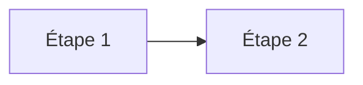

# <Nom du concept>

## TL;DR
<2–3 phrases : ce que c'est et à quoi ça sert.>

## Pourquoi ça existe
<Le problème que ce concept résout. Que se passerait-il sans lui ?>

## Explication détaillée
<Progressive : intuition → analogie → fonctionnement technique précis.>

### <Sous-partie 1>

### <Sous-partie 2>

## Schéma


## Exemples

### Exemple 1 — le plus simple
```<langage>
// code commenté
```
Sortie attendue :
```
...
```

### Exemple 2 — cas courant

### Exemple 3 — cas réaliste

## Pièges courants
- **<Piège>** : <pourquoi ça arrive, comment l'éviter>

## Vu dans le projet
- **Projet** : `<chemin absolu du projet>`
- **Fichier** : `<chemin/fichier:ligne>`
```<langage>
<extrait du code réel>
```
<Explication ligne par ligne.>

## Pour aller plus loin
- [Documentation officielle](<url>)

## Voir aussi
- [<Cours lié>](../<theme>/<fichier>.md)

## Quiz rapide
1. <Question 1>
<details><summary>Réponse</summary>

<Réponse 1>
</details>

2. <Question 2>
<details><summary>Réponse</summary>

<Réponse 2>
</details>

3. <Question 3>
<details><summary>Réponse</summary>

<Réponse 3>
</details>
