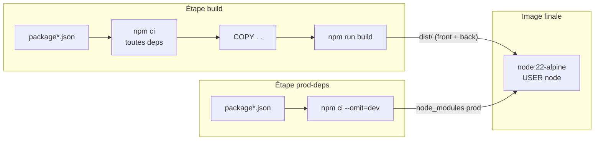

# Dockerfile multi-stage

## TL;DR
Un **Dockerfile multi-étapes (multi-stage build)** enchaîne plusieurs `FROM` dans un même fichier : les premières étapes compilent, la dernière ne récupère (`COPY --from=…`) que le résultat utile. L'image finale est petite, sans outils de build ni code source, donc plus rapide à télécharger et plus sûre.

## Pourquoi ça existe
Pour compiler une app TypeScript il faut TypeScript, Vite, ESLint, les types… Pour l'*exécuter*, il ne faut que Node et quelques dépendances. Avec un seul `FROM`, tout finit dans l'image : des centaines de Mo inutiles, et une surface d'attaque plus grande (chaque paquet est une faille potentielle). Avant le multi-stage, on bricolait deux Dockerfiles et un script pour passer les fichiers de l'un à l'autre.

## Explication détaillée

### L'intuition : l'atelier et la vitrine
Un ébéniste fabrique une table dans son **atelier** (scies, sciure, chutes de bois). Au client, il ne livre que la **table**, pas l'atelier. Les premières étapes sont l'atelier ; la dernière étape est le colis livré.

### Les couches et le cache
Chaque instruction (`FROM`, `COPY`, `RUN`…) crée une **couche (layer)**. Docker met chaque couche en cache : si l'instruction et ses fichiers d'entrée n'ont pas changé, il réutilise le résultat. Dès qu'une couche change, **toutes les suivantes** sont reconstruites. D'où la règle : *copier d'abord ce qui change rarement (package.json), puis ce qui change souvent (le code)*.

### Les étapes nommées
`FROM node:22-alpine AS build` nomme l'étape `build`. Plus loin, `COPY --from=build /app/dist ./dist` copie un dossier depuis cette étape. Les étapes non référencées par la cible finale ne finissent pas dans l'image.

### Sécurité : `USER` et `.dockerignore`
- Par défaut un conteneur tourne en **root**. `USER node` (utilisateur fourni par l'image officielle Node) limite les dégâts si l'app est compromise.
- `.dockerignore` exclut des fichiers du **contexte de build** (ce qui est envoyé à Docker) : `node_modules`, `.env` (secrets !), `.git`…

## Schéma


## Exemples

### Exemple 1 — le plus simple : mono-étape (pour comparer)
```dockerfile
FROM node:22-alpine
WORKDIR /app
COPY . .                 # tout le code, y compris les tests et les sources TS
RUN npm ci               # dépendances de DEV comprises
RUN npm run build
CMD ["node", "dist/index.js"]
```
```bash
docker build -t demo:mono . && docker images demo:mono
```
Sortie attendue (ordre de grandeur) :
```
REPOSITORY   TAG    SIZE
demo         mono   450MB
```

### Exemple 2 — cas courant : deux étapes
```dockerfile
FROM node:22-alpine AS build
WORKDIR /app
COPY package.json package-lock.json ./   # couche stable → cache
RUN npm ci
COPY . .                                 # couche qui change souvent
RUN npm run build

FROM node:22-alpine                      # repart d'une image VIERGE
WORKDIR /app
COPY --from=build /app/dist ./dist       # on ne prend que le résultat
COPY package.json package-lock.json ./
RUN npm ci --omit=dev                    # deps de prod uniquement
USER node
CMD ["node", "dist/index.js"]
```
Sortie attendue : une image nettement plus petite (souvent ÷2 à ÷4).

### Exemple 3 — cas réaliste : observer le cache
```bash
docker build -t demo .                 # 1er build : tout s'exécute
echo "// commentaire" >> src/index.ts  # on modifie seulement du code
docker build -t demo .                 # 2e build
```
Sortie attendue au 2e build (extrait) :
```
 => CACHED [build 3/6] COPY package.json package-lock.json ./
 => CACHED [build 4/6] RUN npm ci
 => [build 5/6] COPY . .
 => [build 6/6] RUN npm run build
```
`npm ci` est sauté : c'est le gain obtenu en copiant les `package.json` avant le code.

## Pièges courants
- **`COPY . .` avant `npm ci`** : toute modification de code invalide le cache des dépendances → réinstallation complète à chaque build.
- **Pas de `.dockerignore`** : `node_modules` local (compilé pour macOS !) écrase celui de l'image, et `.env` finit dans l'image, lisible par quiconque la télécharge.
- **Monorepo et workspaces** : `npm ci` a besoin de *tous* les `package.json` des workspaces pour respecter le lockfile. Les oublier → erreur ou dépendances manquantes.
- **Oublier un fichier de runtime** : ex. le `package.json` qui contient `"type": "module"` ; sans lui Node interprète le JS compilé en CommonJS et plante sur `import`.
- **Shell-form vs exec-form** : `CMD node index.js` lance un shell qui ne transmet pas `SIGTERM` à Node → arrêt brutal après 10 s. Préférer `CMD ["node", "index.js"]`.
- **Chemins relatifs et `WORKDIR`** : le serveur résout `./apps/web/dist` depuis le répertoire courant ; `WORKDIR /app` + `CMD` lancé depuis la racine sont donc indispensables.

## Vu dans le projet
- **Projet** : `/Users/yohan.h/Projet_perso/legalhelp`
- **Fichier** : `Dockerfile:27-52`
```dockerfile
FROM node:22-alpine AS prod-deps
WORKDIR /app
COPY package.json package-lock.json ./
COPY apps/web/package.json apps/web/
COPY apps/server/package.json apps/server/
RUN npm ci --omit=dev

FROM node:22-alpine
WORKDIR /app
ENV NODE_ENV=production
COPY --from=prod-deps /app/node_modules ./node_modules
COPY --from=build /app/apps/web/dist ./apps/web/dist
COPY --from=build /app/apps/server/dist ./apps/server/dist
COPY --from=build /app/apps/server/package.json ./apps/server/package.json
USER node
EXPOSE 3000
CMD ["node", "apps/server/dist/index.js"]
```
- `AS prod-deps` : une étape dédiée qui n'installe que les dépendances de production (`--omit=dev`) ; elle peut être construite en parallèle de `build`.
- Les trois `COPY …package.json` : spécifique au monorepo — npm a besoin des manifestes de chaque workspace (`apps/web`, `apps/server`).
- `FROM node:22-alpine` (sans `AS`) : l'image finale repart de zéro.
- `ENV NODE_ENV=production` : beaucoup de librairies s'optimisent avec cette variable.
- `COPY --from=…` : on cueille `node_modules` (prod) d'une étape et les `dist/` de l'autre. Le code source TypeScript n'entre jamais.
- `apps/server/package.json` : contient `"type": "module"`, nécessaire pour que Node lise `dist/index.js` comme module ES.
- `USER node` : pas de root.
- `EXPOSE 3000` : documentation du port (n'ouvre rien à lui seul).
- `CMD [...]` : forme exec, Node reçoit directement les signaux.

Le `.dockerignore` du projet exclut aussi `docker-compose*.yml` et `Caddyfile` : ces fichiers décrivent l'environnement, pas l'application.

## Pour aller plus loin
- [Multi-stage builds](https://docs.docker.com/build/building/multi-stage/)
- [Référence du Dockerfile](https://docs.docker.com/reference/dockerfile/)
- [Cache de build Docker](https://docs.docker.com/build/cache/)

## Voir aussi
- [GitOps](gitops.md)
- [CI/CD avec GitHub Actions](github-actions-ci-cd.md)
- [Docker Compose](docker-compose.md)

## Quiz rapide
1. Pourquoi copier `package.json` et `package-lock.json` avant le reste du code ?
<details><summary>Réponse</summary>

Pour que la couche `RUN npm ci` reste en cache tant que les dépendances ne changent pas. Modifier du code n'invalide alors que les couches `COPY . .` et suivantes.
</details>

2. Qu'est-ce qui finit réellement dans l'image finale d'un build multi-stage ?
<details><summary>Réponse</summary>

Uniquement l'image de base de la dernière étape et ce qui y est explicitement copié (`COPY --from=…`) ou exécuté. Les étapes intermédiaires (sources, outils de build, deps de dev) sont jetées.
</details>

3. `EXPOSE 3000` rend-il le port accessible depuis l'extérieur ?
<details><summary>Réponse</summary>

Non. C'est de la documentation. C'est la publication de port (`-p` ou `ports:` dans Compose) qui ouvre l'accès depuis l'hôte.
</details>
