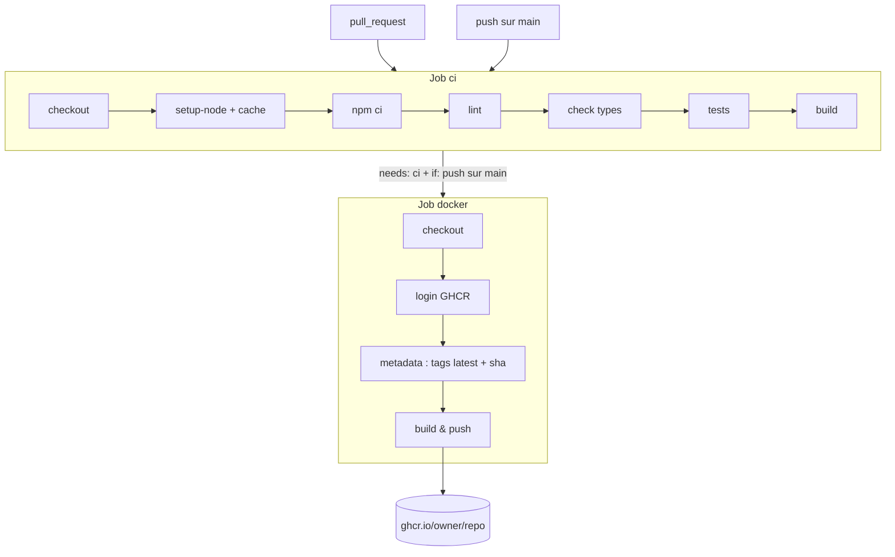

# CI/CD avec GitHub Actions

## TL;DR
L'**intégration continue (Continuous Integration, CI)** vérifie automatiquement chaque modification (lint, types, tests, build). La **livraison continue (Continuous Delivery, CD)** empaquette automatiquement le code validé en un artefact prêt à déployer (ici une image Docker). GitHub Actions exécute ces étapes dans des machines virtuelles, décrites par un fichier YAML dans `.github/workflows/`.

## Pourquoi ça existe
Sans CI, « ça marche sur ma machine » : on fusionne du code qui casse le build ou les tests de quelqu'un d'autre, et on s'en aperçoit trop tard. Sans CD, chaque mise en production est une manipulation manuelle (build local, upload…), lente et source d'erreurs (« j'ai buildé depuis la mauvaise branche »). La CI/CD transforme ces vérifications en **filet de sécurité automatique et reproductible**.

## Explication détaillée

### L'intuition : la chaîne de contrôle qualité
Pense à une usine : chaque pièce (commit) passe sur un tapis roulant, traverse des postes de contrôle (lint → types → tests → build). Une pièce défectueuse est rejetée (croix rouge). Seules les pièces conformes arrivent au poste d'emballage (CD) qui les met en carton (image Docker) et les range en entrepôt (registre GHCR).

### Le vocabulaire GitHub Actions
- **Workflow** : un fichier YAML dans `.github/workflows/`. GitHub les détecte tout seul.
- **Événement (`on`)** : ce qui déclenche le workflow (`push`, `pull_request`, `schedule`, `workflow_dispatch`…).
- **Job** : un groupe d'étapes exécuté sur une machine neuve (`runs-on: ubuntu-latest`). Les jobs tournent **en parallèle** par défaut ; `needs:` crée une dépendance.
- **Step** : une étape. Soit `run:` (une commande shell), soit `uses:` (une **action** réutilisable, ex. `actions/checkout@v4`).
- **Contextes `${{ … }}`** : expressions évaluées par GitHub (`github.ref`, `github.actor`, `secrets.GITHUB_TOKEN`, `steps.<id>.outputs.<nom>`).
- **`if:`** : condition pour exécuter (ou non) un job ou une step.
- **`permissions:`** : les droits du jeton automatique `GITHUB_TOKEN` pour ce job (principe du moindre privilège).

### CI : `npm ci` et l'ordre des vérifications
`npm ci` installe **exactement** ce que dit `package-lock.json` (et échoue s'il est incohérent avec `package.json`), contrairement à `npm install` qui peut le modifier. Les vérifications vont du plus rapide/bon marché au plus coûteux : lint → types → tests → build. On échoue tôt (fail fast).

### CD : registre d'images et tags
Un **registre (registry)** est un entrepôt d'images Docker (Docker Hub, GHCR `ghcr.io`…). Une image a un nom et des **tags** :
- `latest` : tag **mobile**, déplacé à chaque publication — pratique, mais ne dit pas quelle version c'est.
- `sha-0d09dac` : tag **immuable** lié à un commit — traçable, permet le retour arrière précis.

## Schéma


## Exemples

### Exemple 1 — le plus simple : un workflow « hello »
```yaml
# .github/workflows/hello.yml
name: Hello
on: push                 # se déclenche à chaque push, sur toute branche
jobs:
  dire-bonjour:
    runs-on: ubuntu-latest
    steps:
      - run: echo "Bonjour depuis le commit ${{ github.sha }}"
```
Sortie attendue (onglet Actions) :
```
Bonjour depuis le commit 0d09dac3f1…
```

### Exemple 2 — cas courant : CI avec matrice de versions
```yaml
name: CI
on: [push, pull_request]
jobs:
  test:
    runs-on: ubuntu-latest
    strategy:
      matrix:
        node: [20, 22]           # 2 jobs lancés en parallèle
    steps:
      - uses: actions/checkout@v4
      - uses: actions/setup-node@v4
        with:
          node-version: ${{ matrix.node }}
          cache: npm             # réutilise le cache npm entre runs
      - run: npm ci
      - run: npm test
```
Sortie attendue : deux lignes vertes `test (20)` et `test (22)`.

### Exemple 3 — cas réaliste : CI → image Docker, uniquement sur main
```yaml
jobs:
  ci:
    runs-on: ubuntu-latest
    steps:
      - uses: actions/checkout@v4
      - run: npm ci && npm test

  docker:
    needs: ci                                     # attend que ci soit vert
    if: github.event_name == 'push' && github.ref == 'refs/heads/main'
    runs-on: ubuntu-latest
    permissions:
      contents: read
      packages: write                             # droit d'écrire sur GHCR
    steps:
      - uses: actions/checkout@v4
      - uses: docker/login-action@v3
        with:
          registry: ghcr.io
          username: ${{ github.actor }}
          password: ${{ secrets.GITHUB_TOKEN }}   # jeton fourni automatiquement
      - uses: docker/metadata-action@v5
        id: meta                                  # id pour lire ses outputs
        with:
          images: ghcr.io/${{ github.repository }}
          tags: |
            type=raw,value=latest
            type=sha
      - uses: docker/build-push-action@v6
        with:
          push: true
          tags: ${{ steps.meta.outputs.tags }}
```
Sortie attendue (fin du job docker) :
```
pushing ghcr.io/owner/repo:latest
pushing ghcr.io/owner/repo:sha-0d09dac
```

## Pièges courants
- **`npm install` au lieu de `npm ci`** : la CI peut installer des versions différentes de celles testées en local. Toujours `npm ci`.
- **Oublier `permissions: packages: write`** : le push vers GHCR échoue avec `denied: permission_denied`.
- **Publier une image sur une PR** : sans le `if:`, n'importe quelle PR (y compris d'un fork) pourrait écraser `latest`. D'ailleurs, les PR venant de forks reçoivent un `GITHUB_TOKEN` en lecture seule.
- **Nom d'image en majuscules** : les noms d'images Docker doivent être en minuscules. `metadata-action` convertit `github.repository` pour toi ; un `ghcr.io/${{ github.repository }}` écrit à la main dans un `docker build -t` échoue si le compte contient des majuscules (ex. `SamirNaggara`).
- **Une version d'action qui n'existe pas** : `uses: actions/checkout@v99` → `Unable to resolve action`. Vérifier les versions publiées sur la page de l'action.
- **Croire que la CD déploie** : publier une image n'est pas la déployer. Il faut encore qu'un serveur la tire (voir [GitOps](gitops.md)).

## Vu dans le projet
- **Projet** : `/Users/yohan.h/Projet_perso/legalhelp`
- **Fichier** : `.github/workflows/ci.yml:39-76`
```yaml
  docker:
    needs: ci
    if: github.event_name == 'push' && github.ref == 'refs/heads/main'
    runs-on: ubuntu-latest
    permissions:
      contents: read
      packages: write
    steps:
      - uses: actions/checkout@v7
      - uses: docker/login-action@v3
        ...
      - uses: docker/metadata-action@v5
        id: meta
        with:
          images: ghcr.io/${{ github.repository }}
          tags: |
            type=raw,value=latest
            type=sha
      - uses: docker/build-push-action@v6
        with:
          context: .
          push: true
          tags: ${{ steps.meta.outputs.tags }}
          labels: ${{ steps.meta.outputs.labels }}
```
- `needs: ci` : le job docker ne démarre que si le job `ci` (lint, check, test, build) est vert.
- `if: …` : double condition — événement `push` **et** branche `main`. Une PR exécute `ci` mais jamais `docker`.
- `permissions` : le `GITHUB_TOKEN` n'a que le droit de lire le code et d'écrire des paquets.
- `login-action` : connexion à `ghcr.io` avec le jeton automatique, aucun secret à créer.
- `metadata-action` (`id: meta`) : calcule deux tags, `latest` et `sha-<commit court>` ; ses outputs sont relus via `steps.meta.outputs.tags`.
- `build-push-action` : construit avec le `Dockerfile` à la racine (`context: .`) et pousse.

Le tag `sha-…` est déjà publié : c'est lui qu'il faudra utiliser pour un déploiement reproductible.

## Pour aller plus loin
- [Documentation GitHub Actions](https://docs.github.com/en/actions)
- [Travailler avec le Container Registry (GHCR)](https://docs.github.com/en/packages/working-with-a-github-packages-registry/working-with-the-container-registry)
- [docker/metadata-action](https://github.com/docker/metadata-action)
- [docker/build-push-action](https://github.com/docker/build-push-action)
- [npm ci](https://docs.npmjs.com/cli/commands/npm-ci)

## Voir aussi
- [GitOps](gitops.md)
- [Dockerfile multi-stage](dockerfile-multi-stage.md)
- [Docker Compose](docker-compose.md)

## Quiz rapide
1. Pourquoi le job `docker` a-t-il à la fois `needs: ci` et un `if:` ?
<details><summary>Réponse</summary>

`needs: ci` garantit qu'on ne publie qu'un code vérifié ; le `if:` restreint la publication aux push sur `main`. Sans le `if:`, chaque PR verte publierait une image `latest`.
</details>

2. Quelle est la différence entre les tags `latest` et `sha-abc1234` ?
<details><summary>Réponse</summary>

`latest` est déplacé à chaque publication (mobile) ; `sha-abc1234` désigne pour toujours l'image construite depuis ce commit (immuable), ce qui permet de savoir exactement ce qui tourne et de revenir en arrière.
</details>

3. Comment une step lit-elle le résultat d'une step précédente ?
<details><summary>Réponse</summary>

On donne un `id:` à la step productrice, puis on lit `${{ steps.<id>.outputs.<nom> }}` — ici `steps.meta.outputs.tags`.
</details>
