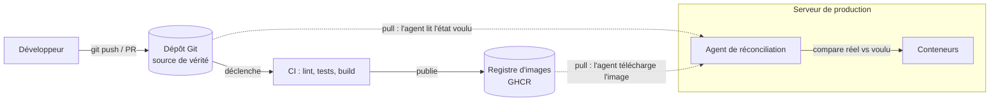

# GitOps

## TL;DR
GitOps, c'est l'idée que **le dépôt Git est la source de vérité unique** de ce qui doit tourner en production : code, mais aussi configuration d'infrastructure (Dockerfile, docker-compose, proxy…). On ne modifie jamais un serveur « à la main » : on modifie Git, et un mécanisme automatique aligne la réalité sur ce que dit Git.

## Pourquoi ça existe
Sans GitOps, la production dérive : quelqu'un se connecte en SSH, change un fichier de config « juste pour tester », oublie de le noter. Six mois plus tard, personne ne sait plus pourquoi le serveur se comporte ainsi, et il est impossible de le reconstruire à l'identique. On appelle ça la **dérive de configuration (configuration drift)** et les serveurs deviennent des « flocons de neige (snowflake servers) » uniques et fragiles.

GitOps résout ça en appliquant à l'infrastructure les outils qu'on utilise déjà pour le code : historique, revue par pull request, retour arrière (`git revert`), traçabilité de qui a changé quoi.

## Explication détaillée

### L'intuition : la partition et l'orchestre
Imagine un orchestre. La **partition** (Git) dit exactement ce qui doit être joué. Le **chef d'orchestre** (l'outil d'automatisation) écoute en permanence et corrige dès qu'un musicien s'écarte de la partition. Personne ne modifie la musique en criant une consigne pendant le concert : on corrige la partition, et le chef applique.

### Les 4 principes (OpenGitOps)
Le groupe de travail OpenGitOps (CNCF) a formalisé quatre principes :

1. **Déclaratif (declarative)** : on décrit l'*état voulu* (« 2 conteneurs, Caddy devant, port 443 ouvert »), pas la suite de commandes pour y arriver. `docker-compose.yml` est déclaratif ; un script shell `docker run … && docker network create …` est impératif.
2. **Versionné et immuable (versioned and immutable)** : cet état voulu est stocké dans Git, avec tout son historique.
3. **Tiré automatiquement (pulled automatically)** : des agents logiciels récupèrent l'état voulu depuis la source.
4. **Réconcilié en continu (continuously reconciled)** : ces agents comparent en boucle l'état réel et l'état voulu, et corrigent l'écart.

### Push vs Pull : deux façons de déployer
- **Modèle push** : la CI (ex. GitHub Actions) *pousse* le déploiement vers le serveur — elle se connecte en SSH et lance `docker compose pull && docker compose up -d`. Simple, mais la CI doit détenir des accès à la production, et si quelqu'un modifie le serveur à la main, rien ne le remet d'aplomb.
- **Modèle pull (GitOps « pur »)** : un agent installé *dans* l'environnement cible (Argo CD, Flux pour Kubernetes) surveille Git et tire les changements lui-même. La CI ne touche jamais la production. Toute dérive est détectée et corrigée.

### Infrastructure as Code (IaC)
GitOps repose sur l'**infrastructure comme code (Infrastructure as Code)** : décrire l'infra dans des fichiers texte versionnés. Dans un projet comme legalhelp, ces fichiers sont : `Dockerfile` (comment fabriquer l'image), `docker-compose.yml` (ce qui tourne et comment ça se parle), `Caddyfile` (comment le trafic entre), `.github/workflows/ci.yml` (comment on vérifie et publie).

## Schéma


## Exemples

### Exemple 1 — le plus simple : impératif vs déclaratif
```bash
# IMPÉRATIF : une suite d'ordres. Si on le relance, ça plante
# (le conteneur "web" existe déjà). Rien ne garde la trace de l'intention.
docker run -d --name web -p 80:80 nginx:1.27
```
```yaml
# DÉCLARATIF (compose.yml) : on décrit l'état voulu.
# `docker compose up -d` peut être relancé 100 fois : il ne fait que
# corriger l'écart entre ce fichier et la réalité (idempotence).
services:
  web:
    image: nginx:1.27
    ports: ['80:80']
```
Sortie attendue au 2e `docker compose up -d` :
```
[+] Running 1/0
 ✔ Container demo-web-1  Running
```

### Exemple 2 — cas courant : déploiement « push » depuis la CI
```yaml
# Job GitHub Actions qui déploie après publication de l'image.
deploy:
  needs: docker
  runs-on: ubuntu-latest
  steps:
    - name: Déployer sur le VPS
      # La CI se connecte au serveur : c'est le modèle PUSH.
      run: |
        ssh deploy@${{ secrets.VPS_HOST }} \
          'cd /srv/legalhelp && docker compose pull && docker compose up -d'
```

### Exemple 3 — cas réaliste : boucle de réconciliation « pull » minimaliste
```bash
#!/bin/sh
# Mini-agent GitOps pour un VPS, lancé toutes les minutes par cron.
# Il TIRE l'état voulu depuis Git et le réconcilie : modèle PULL.
set -eu
cd /srv/legalhelp

git fetch --quiet origin main
if [ "$(git rev-parse HEAD)" != "$(git rev-parse origin/main)" ]; then
  git reset --hard origin/main          # Git a toujours raison
fi

docker compose pull --quiet             # récupère les nouvelles images
docker compose up -d --remove-orphans   # corrige toute dérive
```
Sortie attendue quand rien n'a changé : aucune (tout est déjà conforme). Quand quelqu'un a supprimé un conteneur à la main, il est recréé à la minute suivante.

## Pièges courants
- **Croire que CI/CD = GitOps** : une CI qui publie une image n'est que la moitié. GitOps exige que l'état *déployé* soit décrit dans Git et réconcilié.
- **Le tag `latest`** : si Git dit `image: …:latest`, Git ne dit pas *quelle* version tourne. Deux `pull` à une heure d'écart donnent deux versions différentes pour le même commit. En GitOps strict, on épingle un tag immuable (`sha-0d09dac`) et la mise à jour de ce tag se fait… par un commit.
- **Les secrets dans Git** : « tout dans Git » ne veut pas dire « mots de passe en clair dans Git ». On utilise des secrets de la plateforme (GitHub Secrets), des fichiers `.env` non versionnés, ou des outils de chiffrement (SOPS, Sealed Secrets).
- **Les modifs manuelles « temporaires »** : un `docker compose exec … vi` en prod est exactement la dérive que GitOps veut éliminer. Si c'est utile, ça passe par une PR.

## Vu dans le projet
- **Projet** : `/Users/yohan.h/Projet_perso/legalhelp`
- **Fichier** : `docker-compose.yml:1-12`
```yaml
# Décrit l'ensemble de ce qui tourne : deux conteneurs, et la façon dont ils
# se parlent. Ce fichier est la référence de PRODUCTION — c'est lui, et lui
# seul, qui sera copié sur le VPS.
services:
  app:
    image: ghcr.io/samirnaggara/legalhelp:latest
```
- Lignes 1-3 : c'est la déclaration GitOps du projet — l'état voulu de la production vit dans ce fichier versionné.
- `services:` : description **déclarative** de ce qui doit tourner.
- `image: …:latest` : la CI (`.github/workflows/ci.yml`) publie l'image sur GHCR, le serveur la tire. Le projet est aujourd'hui en **CI/CD avec livraison continue** : l'image est prête, mais il n'y a pas encore d'agent qui réconcilie le VPS. Prochaine étape possible : un job `deploy` (push) ou un script de réconciliation (pull, exemple 3), et l'épinglage d'un tag `sha-…` au lieu de `latest`.

L'ensemble `Dockerfile` + `docker-compose.yml` + `docker-compose.override.yml` + `Caddyfile` + `ci.yml` forme l'**infrastructure as code** du projet, détaillée dans les cours liés ci-dessous.

## Pour aller plus loin
- [OpenGitOps — principes](https://opengitops.dev/)
- [Argo CD — documentation](https://argo-cd.readthedocs.io/)
- [Flux — documentation](https://fluxcd.io/flux/)

## Voir aussi
- [CI/CD avec GitHub Actions](github-actions-ci-cd.md)
- [Dockerfile multi-stage](dockerfile-multi-stage.md)
- [Docker Compose](docker-compose.md)
- [Health check](healthcheck.md)
- [Reverse proxy et HTTPS automatique avec Caddy](../reseaux/reverse-proxy-caddy.md)

## Quiz rapide
1. Quelle est la différence entre le modèle push et le modèle pull ?
<details><summary>Réponse</summary>

En push, la CI se connecte à la production pour déployer (elle a besoin d'accès). En pull, un agent installé dans l'environnement cible lit Git et applique lui-même les changements, et corrige aussi les dérives manuelles.
</details>

2. Pourquoi `image: monapp:latest` est-il problématique en GitOps ?
<details><summary>Réponse</summary>

`latest` est un tag mobile : le même commit Git peut correspondre à des images différentes selon le moment du `pull`. Git n'est donc plus la source de vérité de la version déployée. On préfère un tag immuable (SHA du commit).
</details>

3. `docker compose up -d` est-il déclaratif ou impératif ? Pourquoi ça compte ?
<details><summary>Réponse</summary>

Déclaratif : il compare l'état voulu (le fichier) à l'état réel et ne corrige que l'écart. On peut donc le relancer sans risque (idempotence), ce qui est la base d'une boucle de réconciliation.
</details>
