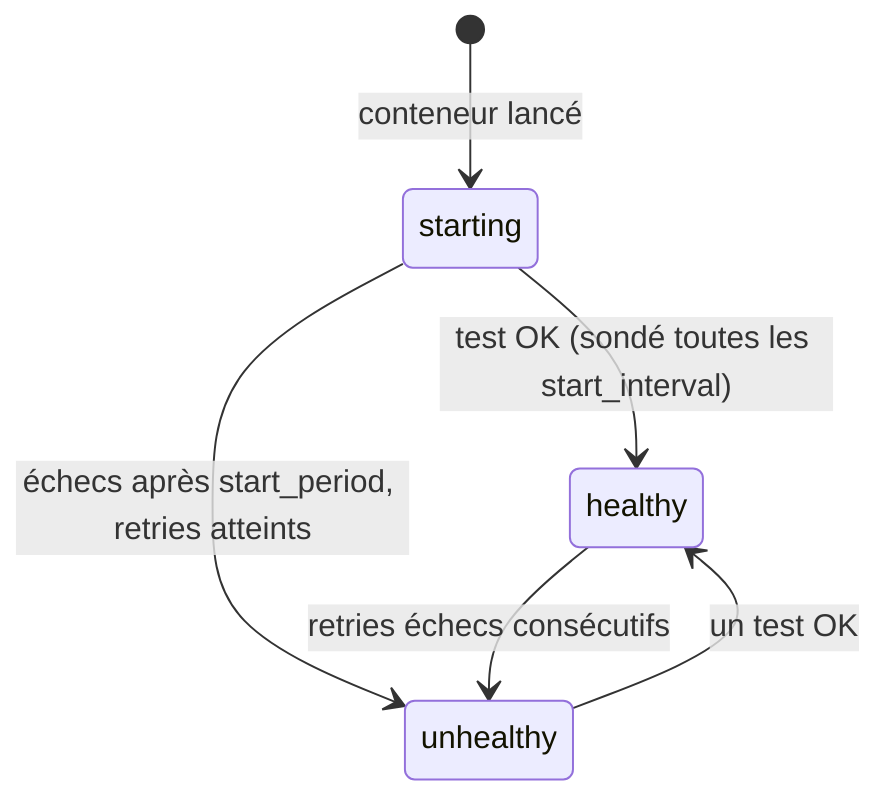

# Health check

## TL;DR
Un **contrôle de santé (health check)** est une vérification automatique et répétée qui répond à la question : « ce service est-il *réellement* capable de servir des requêtes ? ». Côté application, c'est une route (ex. `GET /api/health`) ; côté Docker, c'est une commande lancée périodiquement dont le **code de sortie** fait passer le conteneur en `healthy` ou `unhealthy`.

## Pourquoi ça existe
Un conteneur « démarré » n'est pas un conteneur « prêt ». Le processus peut tourner mais être bloqué (boucle infinie, base de données injoignable, port pas encore ouvert). Sans health check, Docker affiche `Up` et tout le monde lui envoie du trafic → erreurs 502 pour les utilisateurs. Avec un health check, l'outillage peut **décider automatiquement** : attendre avant de démarrer un service dépendant, retirer une instance malade d'un load balancer, annuler un déploiement…

## Explication détaillée

### L'intuition : le médecin de garde
Un infirmier passe toutes les 30 secondes demander au patient « ça va ? ». S'il ne répond pas en 3 secondes, c'est un échec. Trois échecs d'affilée → alerte. Pendant les 10 premières secondes après le réveil d'une anesthésie, on ne compte pas les échecs : le patient a le droit d'être lent.

### Les deux moitiés
1. **L'endpoint applicatif** : l'app expose une route légère qui renvoie `200` si tout va bien, `503 Service Unavailable` sinon. Elle peut vérifier ses dépendances (DB, cache).
2. **La sonde (probe)** : quelqu'un d'externe l'interroge — Docker, Kubernetes (`livenessProbe`, `readinessProbe`), un load balancer, un outil de monitoring, un script de déploiement.

### Les paramètres Docker
| Paramètre | Rôle |
|---|---|
| `test` | commande exécutée **dans** le conteneur ; code de sortie 0 = sain, 1 = malade |
| `interval` | délai entre deux vérifications |
| `timeout` | durée max d'une vérification avant de la compter en échec |
| `retries` | nombre d'échecs **consécutifs** avant `unhealthy` |
| `start_period` | délai de grâce au démarrage : les échecs n'y sont pas comptés |
| `start_interval` | intervalle utilisé pendant `start_period` (sondage rapide pour devenir `healthy` tôt) |

États possibles : `starting` → `healthy` ⇄ `unhealthy`.

### Liveness vs readiness
- **Vivacité (liveness)** : « le processus est-il vivant ? » Si non → le redémarrer.
- **Disponibilité (readiness)** : « peut-il recevoir du trafic maintenant ? » Si non → ne pas lui en envoyer, mais pas forcément le tuer.
Docker n'a qu'une notion (health) et, attention, **Docker seul ne redémarre pas un conteneur `unhealthy`** : il le marque. Ce sont `depends_on`, Swarm, Kubernetes ou un outil tiers qui réagissent.

## Schéma


## Exemples

### Exemple 1 — le plus simple : un healthcheck dans un Dockerfile
```dockerfile
FROM nginx:1.27-alpine
# wget est présent dans l'image alpine ; -q silencieux, --spider = pas de téléchargement
HEALTHCHECK --interval=10s --timeout=2s --retries=3 \
  CMD wget -q --spider http://127.0.0.1/ || exit 1
```
```bash
docker build -t hc-demo . && docker run -d --name hc hc-demo
sleep 15; docker inspect --format '{{.State.Health.Status}}' hc
```
Sortie attendue :
```
healthy
```

### Exemple 2 — cas courant : un endpoint qui vérifie ses dépendances (Hono)
```ts
import { Hono } from "hono";
import { db } from "./db.js"; // hypothétique client de base de données

export const app = new Hono();

app.get("/api/health", async (c) => {
  try {
    await db.query("SELECT 1");          // la DB répond-elle ?
    return c.json({ status: "ok" });     // 200 par défaut
  } catch {
    // 503 : les sondes lisent le CODE HTTP, pas le texte
    return c.json({ status: "degraded", db: "down" }, 503);
  }
});
```
Sortie attendue (`curl -i localhost:3000/api/health` avec DB arrêtée) :
```
HTTP/1.1 503 Service Unavailable
{"status":"degraded","db":"down"}
```

### Exemple 3 — cas réaliste : attendre la santé dans Compose et dans un script de déploiement
```yaml
services:
  app:
    image: ghcr.io/moi/monapp:sha-0d09dac
    healthcheck:
      test: ['CMD', 'node', '-e', "fetch('http://127.0.0.1:3000/api/health').then(r=>process.exit(r.ok?0:1)).catch(()=>process.exit(1))"]
      interval: 30s
      timeout: 3s
      retries: 3
      start_period: 10s
  proxy:
    image: caddy:2-alpine
    depends_on:
      app:
        condition: service_healthy   # attend "healthy", pas juste "started"
```
```bash
# Script de déploiement : --wait bloque jusqu'à ce que tout soit healthy,
# et renvoie un code d'erreur sinon → la CI peut annuler/alerter.
docker compose up -d --wait --wait-timeout 60 && echo "Déploiement OK"
```
Sortie attendue :
```
 ✔ Container demo-app-1    Healthy
 ✔ Container demo-proxy-1  Started
Déploiement OK
```

## Pièges courants
- **Renvoyer `200` avec `{"status":"error"}`** : les sondes ne lisent que le code HTTP (ou le code de sortie). Toujours `503` en cas d'échec.
- **`curl` absent de l'image** : les images `alpine`/`slim` n'ont souvent pas `curl`. Utiliser un outil déjà présent (`wget` sur alpine, `node -e "fetch(...)"` sur une image Node).
- **`localhost` qui résout en IPv6 (`::1`)** : si l'app n'écoute qu'en IPv4, la sonde échoue. `127.0.0.1` est explicite.
- **Un health check trop lourd** : une requête SQL coûteuse toutes les 2 s sur 50 instances, c'est une charge réelle. Garder `SELECT 1`.
- **Vérifier des dépendances externes dans la liveness** : si l'API d'un partenaire tombe, tous tes conteneurs seraient redémarrés en boucle. Les dépendances relèvent de la readiness.
- **`start_period` trop court** : l'app qui met 20 s à démarrer est déclarée `unhealthy` avant même d'être prête.
- **Croire que Docker redémarre les `unhealthy`** : non, `restart:` ne réagit qu'à un processus qui *s'arrête*.

## Vu dans le projet
- **Projet** : `/Users/yohan.h/Projet_perso/legalhelp`
- **Fichiers** : `apps/server/src/app.ts:12-24` et `docker-compose.yml:22-37`
```ts
app.get("/api/health", (c) => {
  return c.json({
    status: "ok",
    uptime: Math.floor(process.uptime()),
  });
});
```
- La route existe dès qu'Hono route : répondre prouve que le processus Node tourne.
- `uptime` : secondes depuis le démarrage. Une valeur qui repart sans cesse de 0 révèle un crash en boucle — une info précieuse que le simple statut ne donne pas.
- Le commentaire du code prévoit déjà l'évolution : vérifier la base de données et renvoyer `503` en cas d'échec (exemple 2).

```yaml
    healthcheck:
      test: ['CMD', 'node', '-e',
        "fetch('http://127.0.0.1:3000/api/health').then((r) => process.exit(r.ok ? 0 : 1)).catch(() => process.exit(1))"]
      interval: 30s
      timeout: 3s
      retries: 3
      start_period: 10s
      start_interval: 2s
```
- `'CMD', 'node', '-e', …` : forme exec, on réutilise Node (déjà dans l'image) au lieu d'ajouter `curl`.
- `127.0.0.1` : la commande s'exécute **dans** le conteneur `app`.
- `r.ok ? 0 : 1` : traduit le statut HTTP (2xx) en code de sortie ; `.catch` couvre le cas « connexion refusée ».
- `interval/timeout/retries` : 3 échecs de plus de 3 s, espacés de 30 s → `unhealthy` en ~1 min 30.
- `start_period: 10s` + `start_interval: 2s` : grâce au démarrage, mais sondage toutes les 2 s pour que Caddy (`condition: service_healthy`) démarre vite.

## Pour aller plus loin
- [HEALTHCHECK (référence Dockerfile)](https://docs.docker.com/reference/dockerfile/#healthcheck)
- [healthcheck (référence Compose)](https://docs.docker.com/reference/compose-file/services/#healthcheck)
- [Liveness, Readiness et Startup probes (Kubernetes)](https://kubernetes.io/docs/tasks/configure-pod-container/configure-liveness-readiness-startup-probes/)

## Voir aussi
- [Docker Compose](docker-compose.md)
- [GitOps](gitops.md)
- [Reverse proxy et HTTPS automatique avec Caddy](../reseaux/reverse-proxy-caddy.md)

## Quiz rapide
1. Que lit Docker pour décider si un healthcheck a réussi ?
<details><summary>Réponse</summary>

Le code de sortie de la commande `test` : 0 = succès, autre = échec. Ni le corps de la réponse HTTP, ni ce qui est affiché.
</details>

2. Un conteneur devient `unhealthy`. Que fait Docker (sans Swarm ni Kubernetes) ?
<details><summary>Réponse</summary>

Il le marque `unhealthy`, c'est tout. Il ne le redémarre pas. Ce statut est exploité par `depends_on: condition: service_healthy`, `docker compose up --wait`, ou des outils externes.
</details>

3. À quoi sert `start_interval` en plus de `start_period` ?
<details><summary>Réponse</summary>

Pendant le délai de grâce, les échecs ne comptent pas, mais un succès fait passer à `healthy`. `start_interval` (2 s) sonde plus souvent que `interval` (30 s) pendant cette phase, pour devenir `healthy` — et débloquer les services dépendants — le plus tôt possible.
</details>
