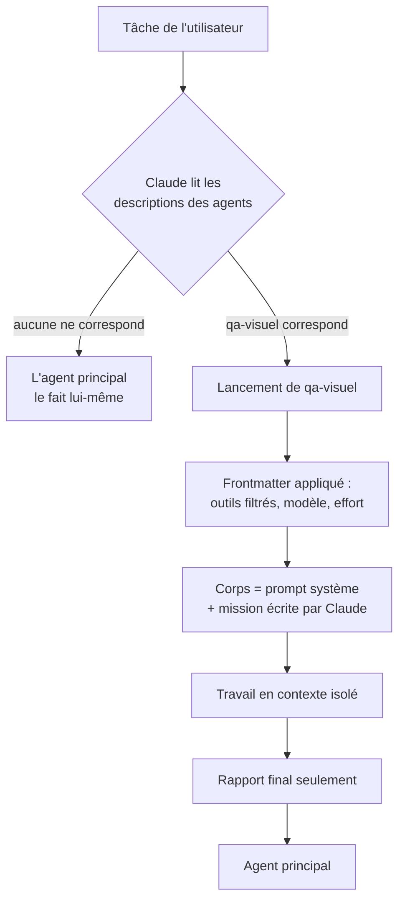

# Créer ses propres sous-agents dans Claude Code

## TL;DR
Un sous-agent perso est un **fichier Markdown** placé dans `~/.claude/agents/` (pour tous tes projets) ou `.claude/agents/` (pour un seul projet). Il commence par un en-tête YAML (*frontmatter*) qui donne son nom, **quand** l'utiliser, ses outils et son modèle. Le corps du fichier est son **prompt système** : son rôle, sa méthode et le format de son rapport. Claude lui délègue automatiquement les tâches qui correspondent à sa description, ou tu l'appelles explicitement avec `@agent-<nom>`.

## Pourquoi ça existe
Sans agent perso, chaque délégation repart de zéro. Il faut réexpliquer le rôle (« tu es relecteur, vérifie l'accessibilité, réponds en liste… »), choisir les outils et rappeler les règles. C'est long, et le résultat change d'une fois à l'autre.

Un agent perso **capture un savoir-faire une fois pour toutes** :
- **cohérence** : le relecteur applique toujours la même grille ;
- **sécurité** : un agent sans `Write` *ne peut pas* modifier tes fichiers, quoi qu'on lui demande ;
- **délégation automatique** : une bonne `description` suffit pour que Claude pense à l'utiliser au bon moment ;
- **économie** : un agent de recherche simple peut tourner sur un modèle plus léger (`haiku`).

## Explication détaillée

### Intuition et analogie : la fiche de poste
Créer un agent, c'est rédiger une **fiche de poste** pour un nouvel employé :
- l'**intitulé** → `name` ;
- **quand faire appel à lui** → `description`, que Claude lit pour décider de déléguer ;
- les **outils** auxquels il a accès → `tools` / `disallowedTools` (on ne donne pas les clés du coffre au stagiaire) ;
- le **niveau d'expérience** → `model` / `effort` ;
- le **manuel de procédure** → le corps du fichier.

Et comme pour un employé : une fiche floue donne un travail flou.

### Anatomie d'un fichier d'agent
```markdown
---
name: reviewer-web                      # identifiant unique, sans ":"
description: Relit le code d'un site…   # QUAND déléguer (le plus important)
tools: Read, Grep, Glob, Bash           # liste blanche d'outils (sinon : tous)
model: sonnet                           # sonnet | opus | haiku | fable | inherit | ID complet
---

Tu es un relecteur de code front-end…   # ← prompt système de l'agent
```
Seuls `name` et `description` sont **obligatoires**. Le nom du fichier n'a pas d'importance : c'est le champ `name` qui identifie l'agent.

### Les champs du frontmatter les plus utiles
| Champ | Rôle | Exemple |
|---|---|---|
| `name` | Identifiant (max 256 caractères, pas de `:`, ne commence pas par `-`) | `qa-visuel` |
| `description` | **Quand** Claude doit déléguer. Ajoute « use proactively » / « à utiliser de façon proactive » pour qu'il le fasse sans qu'on le demande. | `Teste visuellement le site… À utiliser de façon proactive après tout changement d'interface.` |
| `tools` | Liste blanche (allowlist). Si le champ est absent, l'agent hérite de tous les outils. | `Read, Grep, Glob` |
| `disallowedTools` | Liste noire (denylist), appliquée en premier | `Write, Edit` |
| `model` | Modèle à utiliser (`inherit` = celui de ta session) | `haiku` pour la recherche simple |
| `effort` | Profondeur de réflexion | `high` pour un relecteur exigeant |
| `permissionMode` | `default`, `acceptEdits`, `plan`, `auto`… | `plan` = ne fait que proposer |
| `skills` | Skills préchargés dans l'agent | `[frontend-design]` |
| `memory` | Mémoire persistante entre les sessions : `user`, `project` ou `local` | `project` |
| `isolation` | `worktree` : l'agent travaille dans un worktree git temporaire | utile pour un agent qui code en parallèle |
| `maxTurns` | Nombre maximum de tours avant arrêt | `30` (garde-fou contre les boucles) |
| `color` | Couleur dans l'interface | `purple` |
| `hooks`, `mcpServers` | Hooks et serveurs MCP propres à l'agent | — |

Les champs inconnus sont **ignorés sans erreur**. Une faute de frappe (`tool:` au lieu de `tools:`) passe donc inaperçue, et l'agent garde tous ses outils.

### Où placer le fichier, et qui gagne en cas de doublon
| Priorité | Emplacement | Portée |
|---|---|---|
| 1 | Paramètres gérés par l'organisation | Organisation |
| 2 | Option `--agents` en ligne de commande | Session en cours |
| 3 | `.claude/agents/` du projet | Ce projet (versionnable avec git) |
| 4 | `~/.claude/agents/` | Tous tes projets |
| 5 | Dossier `agents/` d'un plugin | Là où le plugin est activé |

Si deux agents ont le même `name`, le plus prioritaire gagne. Tu peux donc avoir un `reviewer-web` général dans `~/.claude/agents/` et le **surcharger** dans un projet précis.

### La description : le champ qui décide de tout
Claude ne lit **que** les descriptions pour choisir à qui déléguer. Le corps du fichier n'est chargé qu'au lancement de l'agent. Une bonne description répond à trois questions :
1. **Que fait-il ?** « Teste visuellement un site web dans Chrome. »
2. **Quand ?** « Après toute modification d'interface, avant de dire qu'une page est terminée. »
3. **Avec quelle insistance ?** « À utiliser de façon proactive. »

Garde-les **courtes** : au-delà d'environ 15 000 tokens cumulés pour tes descriptions, Claude Code affiche un avertissement au démarrage.

### Le corps : écrire un bon prompt système
Une structure qui marche :
1. **Rôle** en une phrase.
2. **Ce que tu reçois** : rappeler que l'agent ne voit pas la conversation, et lui dire quoi lire d'abord (`design-system.md`, `CLAUDE.md`).
3. **Méthode** : des étapes numérotées et concrètes.
4. **Limites** : ce qu'il ne doit pas faire (« ne modifie aucun fichier »).
5. **Format du rapport** : précis et court. Ce rapport est tout ce que l'agent principal recevra.

### Invoquer un agent
- **Automatiquement** : Claude délègue quand la tâche correspond à la `description`.
- **En langage naturel** : « Utilise l'agent qa-visuel pour tester la page contact ».
- **Par @-mention** : `@agent-qa-visuel teste la page contact`. Pour un agent de plugin : `@agent-mon-plugin:nom`.
- **Toute une session** : `claude --agent reviewer-web` fait de l'agent la session principale.

### Ce qu'il faut savoir
- **Contexte vierge** : l'agent ne voit ni ta conversation ni les fichiers déjà lus. Il reçoit seulement ses propres fichiers `CLAUDE.md`, sauf avec `omitClaudeMd: true`.
- **Imbrication** : un sous-agent peut lancer des sous-agents, jusqu'à 3 niveaux. Pour l'en empêcher, retire `Agent` de ses `tools`.
- **Concurrence** : 20 sous-agents simultanés par défaut.
- **Commande `/agents`** : dans les versions récentes de Claude Code, elle rappelle simplement d'éditer les dossiers ou de demander à Claude. L'assistant interactif n'existait que jusqu'à la v2.1.197. Le plus simple : écrire le fichier toi-même ou demander à Claude de le faire.
- **Rechargement** : un agent créé ou modifié en cours de session peut nécessiter une nouvelle session (`/clear` ou relancer `claude`) pour être pris en compte.

## Schéma


## Exemples

### Exemple 1 — le plus simple : un chercheur en lecture seule
`~/.claude/agents/chercheur.md`
```markdown
---
name: chercheur
description: Trouve où une fonctionnalité est implémentée dans le code et l'explique brièvement. À utiliser pour toute question "où / comment est fait X".
tools: Read, Grep, Glob
model: haiku
---

Tu cherches dans le code où est implémenté ce qu'on te demande.
Réponds en 10 lignes maximum : fichiers concernés (chemin:ligne) et explication du fonctionnement.
Ne propose pas de modifications.
```
Test, dans une **nouvelle** session :
```text
> @agent-chercheur où est géré le menu mobile ?
```
Sortie attendue (forme) :
```
● chercheur(Où est géré le menu mobile)
  ⎿ Done
Le menu mobile est géré dans src/components/Header.tsx:42 …
```

### Exemple 2 — cas courant : un relecteur qui ne peut rien casser
`~/.claude/agents/reviewer-web.md`
```markdown
---
name: reviewer-web
description: Relit le code d'un site web (bugs, accessibilité, performance, respect de design-system.md). À utiliser de façon proactive après l'écriture ou la modification de pages ou de composants.
tools: Read, Grep, Glob, Bash
model: inherit
effort: high
color: orange
---

Tu es relecteur de code front-end. Tu ne vois pas la conversation : on te dit quoi relire.

Méthode :
1. Lis design-system.md et CLAUDE.md à la racine s'ils existent.
2. Lis les fichiers à relire (`git diff` si on te parle de changements récents).
3. Vérifie : bugs, accessibilité (alt, contrastes, labels, navigation clavier),
   responsive, performance (images lourdes, JS inutile), cohérence avec la charte.

Ne modifie aucun fichier.

Rapport :
- 🔴 Bloquant / 🟠 À corriger / 🟢 Suggestion — chaque point avec fichier:ligne et correctif proposé.
- Termine par « VERDICT : OK » ou « VERDICT : À CORRIGER ».
```
Ici, `tools` ne contient ni `Write` ni `Edit`. Même si quelqu'un lui demande de corriger, il **ne peut pas** le faire. La sécurité vient de la configuration, pas de la bonne volonté du modèle.

### Exemple 3 — cas réaliste : un QA visuel qui pilote Chrome
`~/.claude/agents/qa-visuel.md`
```markdown
---
name: qa-visuel
description: Teste visuellement un site web dans le navigateur (desktop et mobile, console, liens, formulaires). À utiliser de façon proactive avant de déclarer une page ou une fonctionnalité d'interface terminée.
disallowedTools: Write, Edit, NotebookEdit
model: inherit
maxTurns: 40
color: cyan
---

Tu es testeur QA. On te donne une URL (souvent http://localhost:…) et ce qu'il faut tester.

1. Charge les outils Chrome (mcp__claude-in-chrome__*) en un seul appel ToolSearch, ouvre un NOUVEL onglet.
2. Teste en desktop (1440px) puis mobile (390px) : mise en page, débordements, lisibilité.
3. Lis la console (erreurs JS) et vérifie les liens et formulaires visibles.
4. Ne clique jamais sur ce qui déclenche une alerte JS ni sur une action destructive.

Rapport : liste des anomalies (page, taille d'écran, description, gravité), puis « VERDICT : OK » ou « VERDICT : À CORRIGER ».
```
Ici, on n'utilise pas `tools`, mais `disallowedTools`. L'agent **hérite** de tous les outils, y compris les outils MCP de Chrome, **sauf** ceux d'écriture. C'est pratique quand la liste à autoriser serait longue.

## Pièges courants
- **Description vague** (« agent utile pour le web ») : Claude ne sait pas quand l'utiliser, et l'agent n'est jamais appelé. Décris le *quand* précisément.
- **Faute de frappe dans un champ** : les champs inconnus sont ignorés en silence. Relis `tools`, `disallowedTools`, `model`.
- **Oublier que le contexte est vierge** : le prompt doit dire quoi lire en premier. Ne suppose pas que l'agent « sait » sur quel projet il travaille.
- **Donner tous les outils par défaut** : un relecteur qui peut écrire finira par « corriger » sans qu'on le lui demande. Le principe du moindre privilège s'applique aussi aux agents.
- **Rapport trop long** : tout le rapport atterrit dans le contexte de l'agent principal. Impose un format court et structuré.
- **Trop d'agents qui se chevauchent** : `reviewer`, `relecteur` et `code-checker` ensemble, et Claude hésite. Un rôle = un agent.
- **Agent créé mais introuvable** : vérifie l'emplacement (`~/.claude/agents/` ou `.claude/agents/`), l'extension `.md`, les `---` du frontmatter, et ouvre une nouvelle session.

## Vu dans le projet
- **Projet** : `/Users/yohan.h`
- **Fichier** : `/Users/yohan.h/.claude/agents/` (équipe « site web » créée le 2026-10-21)

Les quatre agents créés pour les projets de sites web suivent exactement les patrons ci-dessus :
- `architecte-web` : lecture seule + recherche web, propose stack et structure ;
- `designer-web` : seul à pouvoir écrire `design-system.md` ;
- `reviewer-web` : exemple 2, sans outils d'écriture ;
- `qa-visuel` : exemple 3, `disallowedTools` pour garder Chrome mais interdire l'écriture.

## Pour aller plus loin
- [Sous-agents dans Claude Code](https://code.claude.com/docs/en/sub-agents)
- [Sous-agents dans l'Agent SDK](https://code.claude.com/docs/en/agent-sdk/subagents)
- [Mémoire de Claude Code (CLAUDE.md)](https://code.claude.com/docs/en/memory)

## Voir aussi
- [Le multi-agent dans Claude Code](multi-agent-claude-code.md) : comment orchestrer ces agents ensemble
- [Agents IA](agents-ia.md) : ce qu'est un agent et la boucle agentique
- [Skills et plugins Claude Code](skills-et-plugins-claude-code.md) : skill ou agent ? et comment partager ses agents via un plugin

## Quiz rapide
1. Tu crées `reviewer-web` avec `tool: Read, Grep` (sans « s »). Que se passe-t-il ?
<details><summary>Réponse</summary>

Le champ `tool` est inconnu, donc **ignoré sans erreur**. Comme `tools` est absent, l'agent hérite de **tous** les outils, y compris `Write` et `Edit`. Ton relecteur « lecture seule » peut donc modifier des fichiers.
</details>

2. Ton agent `qa-visuel` n'est jamais utilisé automatiquement, alors qu'il fonctionne quand tu l'appelles avec `@agent-qa-visuel`. Que faut-il modifier ?
<details><summary>Réponse</summary>

La **`description`**. C'est le seul texte que Claude lit pour décider de déléguer. Elle doit dire *quand* l'utiliser (« avant de déclarer une page terminée ») et contenir une formule comme « à utiliser de façon proactive ».
</details>

3. Pourquoi `qa-visuel` utilise-t-il `disallowedTools` plutôt que `tools` ?
<details><summary>Réponse</summary>

Il a besoin des nombreux outils MCP de Chrome (`mcp__claude-in-chrome__*`), et les lister un par un serait long et fragile. Avec `disallowedTools`, il **hérite de tout sauf** des outils d'écriture. On obtient le même niveau de sécurité avec moins de maintenance.
</details>
