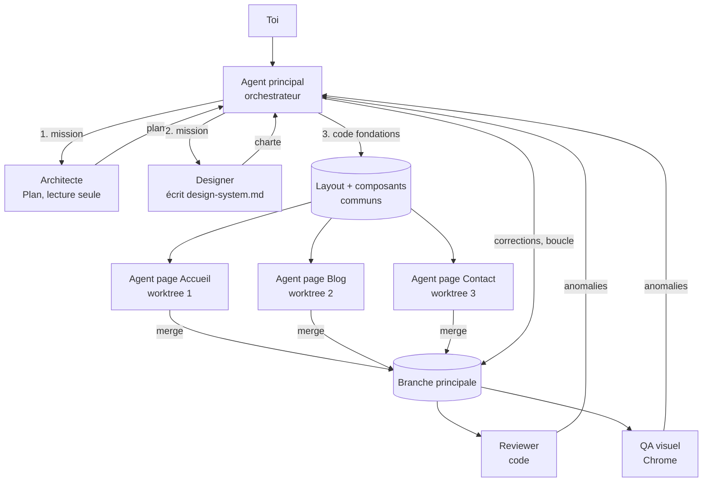

# Le multi-agent dans Claude Code

## TL;DR
Le multi-agent consiste à **répartir un travail entre plusieurs instances de Claude**. Chacune a son propre contexte et sa propre mission, et un agent principal (l'orchestrateur, *orchestrator*) les coordonne. Dans Claude Code, il existe quatre niveaux : le **sous-agent** (outil `Agent`), le **fork**, les **worktrees** pour coder en parallèle sans conflit, et les **workflows** (scripts d'orchestration déterministes). C'est puissant pour explorer, relire, tester et paralléliser des tâches indépendantes. C'est contre-productif pour construire *en même temps* un seul tout cohérent.

## Pourquoi ça existe
Un agent seul se heurte à trois limites :

1. **La fenêtre de contexte (context window)** se remplit. Chaque fichier lu et chaque page web consultée y reste. Au bout d'un moment, l'agent « oublie » le début ou devient moins précis.
2. **Le travail séquentiel est lent.** Lire 40 fichiers, rechercher 5 sujets ou tester 8 pages un par un prend du temps.
3. **Le biais de l'auteur.** L'agent qui vient d'écrire du code a du mal à y voir ses propres erreurs. Il « sait » ce que le code est censé faire.

Le multi-agent répond à chacune de ces limites :
- **isolation** : le sous-agent consomme *son* contexte et ne renvoie que sa conclusion ;
- **parallélisme** : plusieurs agents travaillent en même temps ;
- **regard neuf** : un relecteur ou un testeur qui n'a pas vu la conversation juge le résultat tel qu'il est.

Sans ces mécanismes, on tombe soit sur un agent saturé qui fait tout, soit sur l'humain obligé de découper et coordonner le travail à la main.

## Explication détaillée

### Intuition et analogie : le chef de chantier
Imagine la construction d'une maison.
- **Un seul agent**, c'est un artisan qui fait tout : plans, maçonnerie, électricité, contrôle. C'est cohérent mais lent, et personne ne vérifie son travail.
- **Le multi-agent**, c'est un **chef de chantier** (l'orchestrateur) qui donne des *bons de travail écrits* à des spécialistes : l'architecte, l'électricien, le contrôleur. Chacun travaille dans sa pièce et rend un compte-rendu.

Deux règles découlent de l'analogie :
- **Le bon de travail doit se suffire à lui-même.** Le spécialiste n'a pas assisté aux réunions. S'il est vague, le travail sera faux.
- **On ne met pas deux maçons sur le même mur en même temps.** Le parallélisme ne vaut que pour des zones indépendantes.

### Niveau 1 — le sous-agent (outil `Agent`)
Le sous-agent (sub-agent) est la brique de base. L'agent principal appelle l'outil `Agent` avec :
- une **description** courte (3 à 5 mots) ;
- un **prompt** : la mission complète, car le sous-agent part d'un **contexte vierge** et ne voit pas ta conversation ;
- un **type** (`subagent_type`) qui choisit ses outils et son prompt système.

Les types intégrés les plus utiles :

| Type | Rôle | Outils |
|---|---|---|
| `general-purpose` | Tâches multi-étapes, recherche, code | Tous |
| `Explore` | Fouiller beaucoup de fichiers, rendre la conclusion | Lecture seule |
| `Plan` | Concevoir un plan d'implémentation | Lecture seule |
| *(tes agents perso)* | Définis dans `.claude/agents/*.md` | Ceux que tu choisis |

Ce qui revient à l'agent principal, c'est **uniquement le message final** du sous-agent. Les 30 fichiers lus en route ne polluent pas son contexte. C'est tout l'intérêt de l'**isolation de contexte**.

Autres propriétés importantes :
- **Parallélisme** : si l'agent principal lance plusieurs appels `Agent` *dans le même message*, ils tournent en même temps.
- **Arrière-plan** : les sous-agents tournent en tâche de fond, et l'agent principal est notifié quand ils terminent.
- **Continuation** : avec `SendMessage` et l'identifiant ou le nom de l'agent, on peut relancer un agent existant *avec* son contexte, plutôt que d'en recréer un vide.

### Niveau 2 — le fork
Un **fork** (`subagent_type: "fork"`) est une copie de l'agent principal qui **hérite de toute la conversation**. Pas besoin de tout réexpliquer. Il travaille en arrière-plan et garde ses lectures de fichiers hors du contexte principal.

À utiliser quand la tâche dépend fortement de ce qui a été discuté, par exemple : « vérifie que tout ce qu'on a décidé est bien implémenté ».

### Niveau 3 — les worktrees : paralléliser l'écriture de code
Le danger du parallélisme, c'est **deux agents qui modifient les mêmes fichiers**. Ils s'écrasent mutuellement.

Un **worktree git** est un deuxième (ou troisième…) dossier de travail rattaché au **même dépôt**, mais sur une **branche différente**. Chaque agent a sa propre copie des fichiers, et on fusionne (*merge*) à la fin comme des branches normales.

Dans Claude Code :
- l'option `isolation: "worktree"` d'un sous-agent ou d'un agent de workflow lui crée un worktree temporaire, supprimé automatiquement s'il n'a rien changé ;
- tu peux aussi créer des worktrees à la main et lancer une session `claude` dans chacun (voir l'exemple 2).

Le prérequis est d'avoir un **dépôt git**. Sans `git init`, pas de worktree.

### Niveau 4 — les workflows : l'orchestration déterministe
Avec les sous-agents, c'est **le modèle qui décide** combien d'agents lancer et quand. Un **workflow** est un **script JavaScript** qui fixe la structure : quelles étapes, quoi en parallèle, quoi vérifier. Les briques :

| Fonction | Rôle |
|---|---|
| `agent(prompt, opts)` | Lance un agent. `opts.schema` force une sortie JSON structurée, `opts.isolation: 'worktree'` l'isole, `opts.agentType` utilise un de tes agents perso. |
| `parallel([...])` | Lance tout en même temps et **attend tout le monde** (barrière). |
| `pipeline(items, étape1, étape2…)` | Chaque élément traverse toutes les étapes **sans attendre les autres**. C'est le choix par défaut. |
| `phase(titre)` / `log(msg)` | Regroupe l'affichage et commente la progression. |

Les workflows se déclenchent **seulement sur demande explicite** : dire « utilise un workflow », écrire le mot-clé `ultracode` dans le prompt, ou appeler un workflow sauvegardé. On suit leur progression avec `/workflows`. Ils peuvent lancer des dizaines d'agents, d'où l'opt-in obligatoire.

### Les patrons d'orchestration (patterns)
Ces formes reviennent tout le temps. Elles sont décrites par Anthropic dans *Building effective agents* :

1. **Orchestrateur–ouvriers (orchestrator-workers)** : un chef découpe la tâche, des ouvriers exécutent, le chef assemble.
2. **Éventail (fan-out / fan-in)** : la même action sur N éléments en parallèle (tester 8 pages), puis une synthèse.
3. **Chaîne (pipeline / prompt chaining)** : plan → code → relecture → test, chaque étape nourrissant la suivante.
4. **Générateur–critique (evaluator-optimizer)** : un agent produit, un autre critique, et on boucle jusqu'à ce que le critique soit satisfait.
5. **Vérification adversariale** : plusieurs agents essaient de *réfuter* un résultat. Il ne survit que si la majorité échoue à le réfuter.

### Le coût : la vraie contrainte
Chaque agent **repart de zéro** : il relit les fichiers, recharge les instructions et raisonne de son côté. D'après le retour d'expérience publié par Anthropic sur son système de recherche multi-agents, un agent consomme environ **4×** plus de tokens qu'une simple conversation, et un système multi-agents environ **15×**.

En pratique :
- **Ça vaut le coup** quand la tâche est large et parallélisable, ou quand la qualité compte beaucoup (une relecture indépendante).
- **Ça ne vaut pas le coup** pour une petite modification, un bug dans un seul fichier ou une tâche très séquentielle.

### Quand utiliser quoi
| Situation | Outil |
|---|---|
| « Où est géré X dans ce projet ? » sur un gros code | Sous-agent `Explore` |
| Une recherche sur 3 sujets indépendants | 3 sous-agents en parallèle |
| Relire ce que je viens d'écrire | Sous-agent relecteur (contexte neuf) ou `/code-review` |
| Une tâche qui dépend de toute la discussion | Fork |
| 3 fonctionnalités indépendantes à coder en même temps | Sous-agents + worktrees |
| Un processus répétable et rigoureux (audit, migration, revue complète) | Workflow |
| Corriger une faute de frappe | **Aucun** : l'agent principal suffit |

### Application : créer des sites web en multi-agent
Un site web a une particularité : il doit être **cohérent** (même charte, mêmes composants, même navigation). La bonne stratégie s'organise en trois phases :

1. **Fondations, séquentielles, un seul agent.**
   - Un agent *architecte* (ou `Plan`) propose la stack, l'arborescence des pages et les composants communs.
   - Un agent *designer* écrit `design-system.md` : couleurs, typographie, espacements, ton. **Tous les agents suivants le lisent.**
   - L'agent principal code le layout, le header, le footer et les composants partagés.
2. **Pages, parallélisables.** Une fois les fondations figées, chaque page (accueil, blog, contact…) peut être confiée à un agent dans **son worktree**.
3. **Contrôle, parallélisable aussi.**
   - Un *reviewer* relit le code : bugs, accessibilité, performance.
   - Un *QA visuel* ouvre le site dans le navigateur (Claude in Chrome), teste mobile et desktop, lit la console et renvoie des captures et des anomalies.
   - On boucle (générateur–critique) jusqu'à ce que le QA ne trouve plus rien de bloquant.

Le **contrat partagé** (`design-system.md`, `CLAUDE.md` du projet, liste des composants) remplace la conversation que les sous-agents n'ont pas vue.

## Schéma


## Exemples

### Exemple 1 — le plus simple : demander des sous-agents en parallèle
Pas de code ici, juste un prompt bien formulé dans Claude Code :

```text
Lance 3 sous-agents Explore en parallèle :
1. Dans src/components, liste chaque composant et ses props.
2. Dans src/pages, liste les routes et les composants qu'elles utilisent.
3. Dans styles/ et tailwind.config.js, résume la charte (couleurs, polices, breakpoints).
Ensuite, fais-moi une synthèse en 15 lignes de l'architecture du site.
```

Ce qui se passe :
```
● Agent(Explore: composants)   ── en parallèle ──┐
● Agent(Explore: routes)       ── en parallèle ──┤→ 3 conclusions courtes
● Agent(Explore: charte)       ── en parallèle ──┘
● Synthèse de l'agent principal (son contexte n'a reçu que les 3 conclusions)
```
Le mot-clé « en parallèle » compte : l'agent lance alors les 3 appels dans le même message.

### Exemple 2 — cas courant : coder 2 pages en parallèle avec des worktrees
```bash
# Prérequis : le projet est un dépôt git avec les fondations commitées
cd ~/projets/mon-site
git add -A && git commit -m "Fondations : layout, header, footer, design-system.md"

# Crée deux dossiers de travail, chacun sur sa propre branche
git worktree add ../mon-site-blog    -b page-blog
git worktree add ../mon-site-contact -b page-contact

git worktree list
```
Sortie attendue :
```
/Users/toi/projets/mon-site          a1b2c3d [main]
/Users/toi/projets/mon-site-blog     a1b2c3d [page-blog]
/Users/toi/projets/mon-site-contact  a1b2c3d [page-contact]
```
Ensuite, ouvre deux terminaux, un `claude` par dossier, chacun avec sa mission (« crée la page blog en respectant design-system.md »). À la fin :
```bash
cd ~/projets/mon-site
git merge page-blog
git merge page-contact          # les conflits sont rares si les pages sont indépendantes
git worktree remove ../mon-site-blog
git worktree remove ../mon-site-contact
```
La même chose peut être faite par Claude : « code les pages blog et contact en parallèle avec deux sous-agents isolés en worktree ».

### Exemple 3 — cas réaliste : un workflow « pages + revue + QA »
Ce script se lance quand tu demandes explicitement un workflow. Il prend la liste des pages en argument (`args`) et fait passer chaque page dans un **pipeline** : code (en worktree), puis revue, puis QA. Chaque page avance à son rythme.

```javascript
export const meta = {
  name: 'build-site-pages',
  description: 'Code chaque page en parallèle (worktree), puis la relit et la teste',
  phases: [{ title: 'Code' }, { title: 'Revue' }, { title: 'QA' }],
}

// Schéma de sortie imposé au relecteur et au testeur : du JSON validé, pas du texte libre
const REPORT = {
  type: 'object',
  properties: {
    ok: { type: 'boolean' },
    problems: { type: 'array', items: { type: 'string' } },
  },
  required: ['ok', 'problems'],
}

// args = ["accueil", "blog", "contact"]
const results = await pipeline(
  args,
  // Étape 1 : chaque page dans son propre worktree pour éviter les conflits
  page => agent(
    `Crée la page "${page}" du site. Lis d'abord design-system.md et réutilise
     les composants de src/components. Commite sur une branche page-${page}.`,
    { label: `code:${page}`, phase: 'Code', isolation: 'worktree' }),
  // Étape 2 : revue par un agent perso "reviewer-web" (défini dans .claude/agents/)
  (codeResult, page) => agent(
    `Relis la branche page-${page} : bugs, accessibilité, respect de design-system.md.`,
    { label: `revue:${page}`, phase: 'Revue', agentType: 'reviewer-web', schema: REPORT }),
  // Étape 3 : QA visuel seulement si la revue est passée
  (review, page) => review.ok
    ? agent(`Ouvre la page ${page} dans le navigateur, teste mobile et desktop, lis la console.`,
        { label: `qa:${page}`, phase: 'QA', agentType: 'qa-visuel', schema: REPORT })
    : { ok: false, problems: review.problems },
)

return results.map((r, i) => ({ page: args[i], ...r }))
```
Sortie attendue (renvoyée à l'agent principal) :
```json
[
  { "page": "accueil", "ok": true,  "problems": [] },
  { "page": "blog",    "ok": false, "problems": ["Contraste insuffisant sur les dates", "Image sans alt"] },
  { "page": "contact", "ok": true,  "problems": [] }
]
```
L'agent principal corrige ensuite `blog` et fusionne les branches.

## Pièges courants
- **Mission vague** : « continue ce qu'on faisait » ne veut rien dire pour un sous-agent qui n'a pas vu la conversation. Donne le but, les fichiers, les contraintes et le format de réponse attendu. Sinon, utilise un fork.
- **Paralléliser trop tôt** : lancer 5 agents sur un site vide produit 5 styles différents. Construis d'abord les fondations et le `design-system.md`, puis parallélise.
- **Deux agents sur les mêmes fichiers sans worktree** : ils s'écrasent mutuellement et tu perds du travail. Utilise l'isolation en worktree ou découpe par fichiers disjoints.
- **Utiliser des agents par réflexe** : pour une modification de 3 lignes, un sous-agent coûte plus cher et va plus lentement. La règle : si l'agent principal peut le faire en lisant 1 ou 2 fichiers, il le fait lui-même.
- **Faire confiance aveuglément au rapport** : un sous-agent peut dire « c'est fait, tout marche » sans l'avoir vérifié. Demande des preuves (sortie des tests, captures) ou ajoute un vérificateur.
- **Oublier `git init`** : pas de dépôt, pas de worktree. Et sans commits réguliers, on ne peut pas revenir en arrière après une mauvaise fusion.
- **Lancer un workflow sans limite** : des dizaines d'agents, c'est beaucoup de tokens. Commence petit (3 pages, 1 relecteur) et augmente seulement si le résultat le justifie.

## Vu dans le projet
- **Projet** : `/Users/yohan.h`
- **Fichier** : aucun, demandé hors contexte de code.

Ce cours prépare deux suites : la création d'agents perso (voir [Créer ses propres sous-agents](creer-des-sous-agents-claude-code.md)) dans `~/.claude/agents/` — `architecte-web`, `designer-web`, `reviewer-web`, `qa-visuel` — puis leur test sur un vrai site.

## Pour aller plus loin
- [Sous-agents dans Claude Code](https://code.claude.com/docs/en/sub-agents)
- [Sous-agents dans l'Agent SDK](https://code.claude.com/docs/en/agent-sdk/subagents)
- [Workflows courants de Claude Code (dont les worktrees)](https://code.claude.com/docs/en/common-workflows)
- [git worktree (documentation Git)](https://git-scm.com/docs/git-worktree)
- [Building effective agents (Anthropic)](https://www.anthropic.com/engineering/building-effective-agents)
- [How we built our multi-agent research system (Anthropic)](https://www.anthropic.com/engineering/multi-agent-research-system)

## Voir aussi
- [Créer ses propres sous-agents dans Claude Code](creer-des-sous-agents-claude-code.md) : écrire les agents spécialisés que l'orchestrateur va utiliser
- [Agents IA](agents-ia.md) : la boucle agentique et les bases des sous-agents
- [Skills et plugins Claude Code](skills-et-plugins-claude-code.md) : les plugins peuvent embarquer des sous-agents tout prêts

## Quiz rapide
1. Tu demandes à un sous-agent `Explore` « vérifie si le bug dont on a parlé est corrigé ». Il répond n'importe quoi. Pourquoi, et quelles sont les deux solutions ?
<details><summary>Réponse</summary>

Le sous-agent démarre avec un **contexte vierge** : il ne sait pas de quel bug il s'agit. Première solution : réécrire la mission pour qu'elle se suffise à elle-même (fichier, symptôme, comportement attendu). Seconde solution : utiliser un **fork**, qui hérite de toute la conversation.
</details>

2. Pourquoi faut-il construire le layout et le `design-system.md` *avant* de paralléliser la création des pages ?
<details><summary>Réponse</summary>

Les agents parallèles ne se voient pas entre eux. Sans fondations communes, chacun invente sa propre charte et ses propres composants, et le site devient incohérent. Le `design-system.md` et les composants partagés servent de **contrat** que tous lisent : c'est ce qui remplace la coordination.
</details>

3. Dans l'exemple 3, pourquoi utiliser `pipeline()` plutôt que trois `parallel()` successifs (tout coder, puis tout relire, puis tout tester) ?
<details><summary>Réponse</summary>

`parallel()` est une **barrière** : il attend que *toutes* les pages soient codées avant de commencer la moindre revue. Avec `pipeline()`, la page « accueil » peut être en QA pendant que « blog » est encore en cours de codage. La durée totale correspond à la chaîne la plus lente, et non à la somme des étapes les plus lentes. Une barrière ne se justifie que si une étape a besoin de **tous** les résultats précédents ensemble (par exemple pour dédupliquer).
</details>
