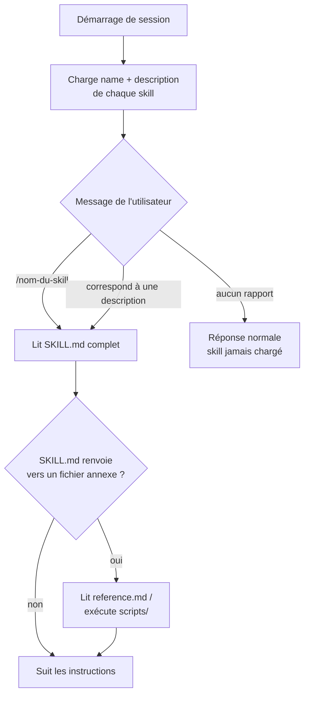
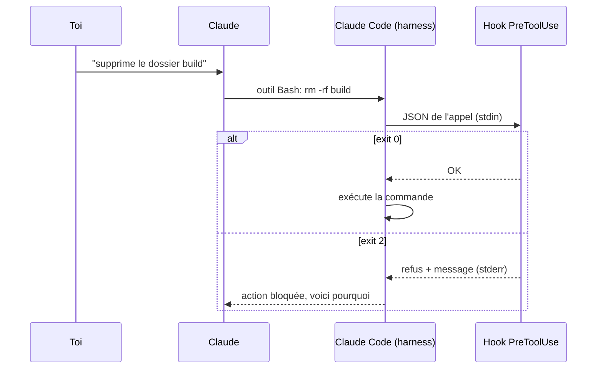

# Skills et plugins Claude Code

## TL;DR
Un **skill** est un dossier contenant un fichier `SKILL.md` : des instructions que Claude charge **seulement quand la tâche s'y prête**. Un **plugin** est un **paquet** distribuable qui peut regrouper des skills, des commandes slash, des sous-agents (sub-agents), des hooks et des serveurs MCP. Les trois premiers ne sont que du Markdown. Les hooks et les serveurs MCP sont du **vrai code exécuté sur ta machine**.

## Pourquoi ça existe
Sans skills, il faudrait recopier les mêmes consignes à chaque conversation (« écris le cours dans tel dossier, avec tel format… ») ou tout mettre dans `CLAUDE.md`, qui est chargé **en entier à chaque session** et coûte des tokens même quand c'est inutile.

Les skills résolvent ça grâce au **chargement progressif** (progressive disclosure) : Claude ne voit d'abord qu'une ligne de description par skill et ne lit le reste qu'au besoin.

Les plugins résolvent un autre problème, le **partage**. Une seule commande `/plugin install` installe en une fois tout un ensemble cohérent (instructions, commandes, automatismes, outils), versionné et désinstallable.

## Explication détaillée

### Analogie
Imagine Claude comme un employé polyvalent.
- Un **skill** est une **fiche procédure** rangée dans un classeur. L'employé ne lit que les titres des fiches et ouvre la bonne quand une tâche correspond.
- Une **commande slash** est un **bouton raccourci** : « fais la procédure X maintenant ».
- Un **sous-agent** est un **collègue spécialisé** à qui on délègue une sous-tâche. Il travaille dans son propre bureau (son propre contexte) et ne rapporte que la conclusion.
- Un **hook** est une **alarme automatique** posée par le bâtiment lui-même : elle se déclenche à un moment précis, que l'employé le veuille ou non.
- Un **serveur MCP** est une **nouvelle machine** branchée au bureau (accès à Gmail, à une base de données, à une API…).
- Un **plugin** est un **kit livré dans un carton** qui contient n'importe quelle combinaison des éléments ci-dessus.

### Les skills en détail

Structure minimale :
```
mon-skill/
├── SKILL.md          ← obligatoire : frontmatter YAML + instructions
├── reference.md      ← optionnel : docs détaillées, lues seulement si SKILL.md y renvoie
└── scripts/outil.py  ← optionnel : scripts que Claude peut exécuter
```

Le frontmatter contient deux champs essentiels :
- `name` : l'identifiant, qui donne aussi le nom de la commande `/name` ;
- `description` : **le champ le plus important**. C'est ce texte qui décide si Claude déclenche le skill. Il doit dire **quoi** fait le skill et **quand** l'utiliser, avec les mots que tu emploies réellement.

Le cycle de vie se déroule en trois temps :
1. **Démarrage** : seuls `name` et `description` de chaque skill entrent dans le contexte, ce qui coûte quelques dizaines de tokens par skill.
2. **Déclenchement** : soit automatique (ta demande correspond à la description), soit manuel (`/nom-du-skill arguments`).
3. **Exécution** : Claude lit le `SKILL.md` complet et, si besoin, les fichiers annexes.

### Où vivent les skills, et qui les voit

| Emplacement | Portée | Qui le voit |
|---|---|---|
| `~/.claude/skills/<nom>/` | Personnel | Toi, sur cette machine et cette session macOS |
| `<projet>/.claude/skills/<nom>/` | Projet | Toute personne qui clone le repo (via git) |
| Plugin installé | Selon l'installation (utilisateur, projet ou local) | Selon la portée choisie |
| Ajouté sur **claude.ai** (Settings → Capabilities) | **Compte** | **Toutes les machines connectées au compte.** Les skills sont synchronisés dans `~/.claude/skills/synced/<id-compte>/` |

> **Compte partagé** : pour ne pas imposer tes skills aux autres, crée-les **en local** (`~/.claude/skills/`) et pas via claude.ai. Pour une séparation complète, il faut un compte par personne.

### Les plugins et leurs composants

Arborescence complète d'un plugin :
```
mon-plugin/
├── .claude-plugin/
│   └── plugin.json      ← manifeste (nom, version, description, auteur)
├── skills/<nom>/SKILL.md
├── commands/<nom>.md    ← commandes slash
├── agents/<nom>.md      ← sous-agents
├── hooks/hooks.json     ← déclaration des hooks
├── scripts/…            ← code appelé par les hooks
└── .mcp.json            ← serveurs MCP à lancer
```

| Composant | Format | Qui le déclenche | Exécute du code ? |
|---|---|---|---|
| Skill | Markdown | Claude (automatique) ou toi (`/nom`) | Non, mais il peut demander à Claude de lancer des scripts (avec permission) |
| Commande slash | Markdown | Toi (`/nom`) | Non |
| Sous-agent | Markdown | Claude, quand il délègue | Non (il utilise les outils autorisés) |
| **Hook** | JSON + script | **Claude Code lui-même**, sur un événement | **Oui, automatiquement** |
| **Serveur MCP** | JSON + programme | Démarré avec la session | **Oui, en continu** |

**Commandes slash.** Un fichier `commands/revue.md` crée `/revue`. `$ARGUMENTS` y est remplacé par ce que tu tapes après la commande. Dans les versions récentes, commandes et skills ont fusionné : un skill est aussi invocable par `/nom`. Les commandes restent utiles pour des prompts simples qui ne doivent jamais se déclencher tout seuls.

**Sous-agents.** Un fichier `agents/reviewer.md` décrit un agent avec son rôle, ses outils autorisés et éventuellement son modèle. Claude lui délègue une tâche. L'agent travaille dans un **contexte séparé** et ne renvoie que son résultat, ce qui garde la conversation principale propre et économise des tokens.

**Hooks.** Ce sont des commandes shell exécutées à des **événements** du cycle de vie :

| Événement | Moment |
|---|---|
| `SessionStart` | Début de session |
| `UserPromptSubmit` | Tu envoies un message |
| `PreToolUse` | Avant que Claude utilise un outil (peut **bloquer** l'action) |
| `PostToolUse` | Après l'utilisation d'un outil |
| `Stop` | Claude a fini de répondre |
| `PreCompact` | Avant une compaction du contexte |

Le script reçoit un JSON sur l'entrée standard (stdin). S'il sort avec le **code 2**, l'action est bloquée et son message d'erreur (stderr) est renvoyé à Claude. C'est le seul composant **déterministe** : un skill peut être ignoré par Claude, un hook s'exécute toujours.

**Serveurs MCP** (Model Context Protocol). Ce sont des programmes qui exposent de **nouveaux outils** à Claude (lire Gmail, interroger une base Postgres…). Dans les versions récentes de Claude Code, leurs outils sont **différés** (chargés à la demande, *tool search*) : seuls leurs noms sont connus au départ, et la définition complète n'est chargée que quand Claude en a besoin. `/context` l'affiche : « MCP tools · loaded on-demand · 0 tokens ». Sur d'anciennes versions, ou si ce mécanisme est désactivé, toutes les définitions étaient envoyées à chaque requête, ce qui coûtait cher.

### Marketplaces et installation
Une **marketplace** est un repo git contenant `.claude-plugin/marketplace.json`, la liste des plugins disponibles.
```
/plugin marketplace add auteur/repo   # ajouter une source
/plugin install nom@marketplace       # installer un plugin
/plugin                               # menu : voir, activer, désactiver, désinstaller
```
Les skills d'un plugin sont rangés sous un **espace de noms** (namespace) : `/nom-plugin:nom-skill`. Cela évite les collisions entre plugins.

### Skills et plugins « anti-tokens » (Caveman & co)
**Caveman** est le plus populaire. Il force des réponses télégraphiques (« Bug ligne 42. Variable null. Fix : check. ») et annonce environ 75 % de tokens **de sortie** en moins.

Mais la sortie n'est qu'une petite part de la consommation. Le gros vient :
- des **entrées et sorties d'outils** (fichiers lus, résultats de commandes), environ 30 à 45 % ;
- du **contexte de base** (system prompt, outils, CLAUDE.md, descriptions de skills), environ 30 à 50 %, en partie mis en cache ;
- et surtout, dans une longue session, de **l'historique des messages**, renvoyé à chaque tour. Exemple réel : `/context` affichait 108k tokens de messages sur 139k au total, contre 6k pour 32 skills et 0 pour 45 outils MCP différés.

Les leviers les plus efficaces sont natifs :

| Action | Effet |
|---|---|
| `/clear` entre deux tâches | Repart d'un historique vide. **C'est le levier n°1**, car chaque message renvoie tout l'historique. |
| `/compact` | Résume l'historique d'une longue tâche **que tu continues dans la même session**. Inutile juste avant de quitter : une nouvelle session repart de zéro, le résumé serait jeté. |
| `/context` | Montre ce qui occupe le contexte |
| Note de passation dans un fichier | Pour reprendre plus tard une tâche dans une session neuve, sans recharger tout l'historique (contrairement à `--continue` / `/resume`) |
| CLAUDE.md court | Il est chargé à chaque session |
| Demandes précises (« regarde `src/auth.ts` ») | Moins d'exploration |
| `/model` plus léger pour les tâches simples | Coût par token réduit |

## Schéma

Cycle de vie d'un skill :


Ce qui se passe quand Claude veut lancer une commande Bash avec un plugin qui a un hook :


## Exemples

### Exemple 1 — le plus simple : un skill personnel
Fichier `~/.claude/skills/concis/SKILL.md` :
```markdown
---
name: concis
description: Répond de façon très courte et directe, sans politesse ni résumé final. Utiliser quand l'utilisateur dit "réponse courte", "sois concis", "/concis".
---

# Mode concis

- Réponds en 5 lignes maximum.
- Pas de phrase d'introduction ni de conclusion.
- Code uniquement si demandé.
```
Test : relance Claude Code, puis tape :
```
/concis c'est quoi un port réseau ?
```
Sortie attendue (approximative) :
```
Numéro (0–65535) qui identifie un service sur une machine.
IP = l'immeuble, port = l'appartement.
Ex : 80 HTTP, 443 HTTPS, 22 SSH.
```

### Exemple 2 — cas courant : un mini-plugin avec une commande et un sous-agent
```
revue-plugin/
├── .claude-plugin/plugin.json
├── commands/revue.md
└── agents/relecteur.md
```

`.claude-plugin/plugin.json` :
```json
{
  "name": "revue-plugin",
  "version": "1.0.0",
  "description": "Relecture de code rapide",
  "author": { "name": "Moi" }
}
```

`commands/revue.md` crée la commande `/revue-plugin:revue` :
```markdown
---
description: Relit un fichier et liste les bugs probables
argument-hint: <fichier>
---
Délègue au sous-agent "relecteur" la relecture de $ARGUMENTS.
Affiche ensuite ses trouvailles, de la plus grave à la moins grave.
```

`agents/relecteur.md` :
```markdown
---
name: relecteur
description: Relit du code et signale les bugs. Utiliser pour toute relecture de fichier.
tools: Read, Grep, Glob
---
Tu es un relecteur strict. Lis le fichier demandé, cherche les bugs
de logique et les cas limites. Réponds par une liste numérotée
"ligne — problème — correction suggérée". Ne modifie rien.
```
Le relecteur n'a que des outils de **lecture** (`tools:`), il ne peut donc rien casser. Il lit le fichier dans son propre contexte, et seule la liste finale revient dans ta conversation.

Tester en local sans marketplace :
```bash
claude --plugin-dir ./revue-plugin
```
Puis, dans Claude Code :
```
/revue-plugin:revue src/app.py
```
Sortie attendue (exemple) :
```
1. ligne 12 — division par zéro si liste vide — vérifier len(items) avant
2. ligne 30 — fichier jamais fermé — utiliser "with open(...)"
```

### Exemple 3 — cas réaliste : un hook qui bloque les commandes dangereuses
Ajout à un plugin : `hooks/hooks.json`.
```json
{
  "hooks": {
    "PreToolUse": [
      {
        "matcher": "Bash",
        "hooks": [
          {
            "type": "command",
            "command": "${CLAUDE_PLUGIN_ROOT}/scripts/garde-fou.sh"
          }
        ]
      }
    ]
  }
}
```
- `matcher: "Bash"` : le hook ne s'applique qu'à l'outil Bash.
- `${CLAUDE_PLUGIN_ROOT}` : chemin du plugin installé, quel que soit l'endroit où il est rangé.

`scripts/garde-fou.sh` (à rendre exécutable avec `chmod +x`) :
```bash
#!/usr/bin/env bash
# Claude Code envoie sur stdin un JSON du type :
# {"tool_name":"Bash","tool_input":{"command":"rm -rf /"} , ...}
cmd=$(jq -r '.tool_input.command')        # extrait la commande demandée

if echo "$cmd" | grep -Eq 'rm -rf (/|~)'; then
  echo "Refusé : suppression récursive de / ou ~ interdite." >&2
  exit 2                                  # 2 = bloquer, stderr renvoyé à Claude
fi
exit 0                                    # 0 = laisser passer
```
Test manuel du script, sans Claude :
```bash
echo '{"tool_name":"Bash","tool_input":{"command":"rm -rf ~"}}' | ./scripts/garde-fou.sh; echo "code=$?"
```
Sortie attendue :
```
Refusé : suppression récursive de / ou ~ interdite.
code=2
```
C'est aussi exactement le genre de code qu'un plugin malveillant pourrait utiliser à l'inverse, par exemple pour envoyer tes fichiers ailleurs. D'où la règle : **toujours lire `hooks/` et `.mcp.json` avant d'installer un plugin.**

## Pièges courants
- **Description vague** : « Aide pour les cours » ne se déclenche jamais ou se déclenche à tort. Il faut écrire *quoi* et *quand*, avec des phrases déclencheuses réelles.
- **Croire qu'un skill est obligatoire pour Claude** : Claude peut ne pas le déclencher, ou s'écarter des instructions. Pour une règle qui doit **toujours** s'appliquer (bloquer, formater, notifier), utilise un **hook**.
- **SKILL.md énorme** : tout est chargé dès le déclenchement. Mets les détails dans des fichiers annexes référencés.
- **Ajouter un skill via claude.ai sur un compte partagé** : il est synchronisé chez tout le monde (`~/.claude/skills/synced/`). Préfère `~/.claude/skills/`.
- **Installer un plugin vu sur Insta sans le lire** : les hooks et les MCP exécutent du code avec tes droits. Il faut lire `plugin.json`, `hooks/` et `.mcp.json`.
- **Penser que Caveman divise la facture par 4** : il ne réduit que la sortie. `/clear` entre deux tâches rapporte bien plus.
- **Croire que désactiver les MCP fait économiser beaucoup** : avec le chargement à la demande, leurs outils ne coûtent presque rien tant qu'ils ne servent pas. Vérifie avec `/context` avant d'optimiser. Le vrai poste de dépense est l'historique de la conversation.
- **`/compact` juste avant de quitter** : ça coûte un appel au modèle pour rien, puisque la session suivante démarre vide.
- **Modifier un skill et ne pas voir le changement** : il faut relancer la session.

## Vu dans le projet
- **Projet** : `/Users/yohan.h`
- **Fichier** : `/Users/yohan.h/.claude/skills/cours/SKILL.md:1` (lien symbolique vers `/Users/yohan.h/all-memory/.claude-skill/cours`)
```markdown
---
name: cours
description: Crée un cours détaillé en Markdown (explications, exemples, schémas, pièges, quiz) sur un concept technique que l'utilisateur ne connaît pas, et l'enregistre dans sa base de connaissances ~/all-memory, quel que soit le projet courant. Utiliser quand l'utilisateur dit "fais-moi un cours sur X", "crée-moi un cours", "je ne connais pas ce concept", "explique-moi X en détail", "/cours X".
---
```
- `---` … `---` : le frontmatter YAML, la seule partie chargée au démarrage.
- `name: cours` : donne la commande `/cours`. C'est d'ailleurs ce skill qui a produit ce cours.
- `description:` : la première moitié dit **quoi** (cours détaillé, enregistré dans `~/all-memory`), la seconde dit **quand** (« fais-moi un cours sur X »…). C'est un bon modèle de description.
- Le lien symbolique permet de **versionner** le skill dans le repo `all-memory` tout en le rendant visible par Claude Code.

À côté, `/Users/yohan.h/.claude/skills/synced/<id-compte>/` contient les skills synchronisés depuis le **compte claude.ai** (docx, pdf, pptx, skill-creator…) : ce sont ceux que verrait toute personne connectée au même compte.

## Pour aller plus loin
- [Skills — documentation Claude Code](https://code.claude.com/docs/en/skills)
- [Plugins](https://code.claude.com/docs/en/plugins)
- [Référence des plugins](https://code.claude.com/docs/en/plugins-reference)
- [Marketplaces de plugins](https://code.claude.com/docs/en/plugin-marketplaces)
- [Commandes slash](https://code.claude.com/docs/en/slash-commands)
- [Sous-agents](https://code.claude.com/docs/en/sub-agents)
- [Hooks](https://code.claude.com/docs/en/hooks)
- [MCP](https://code.claude.com/docs/en/mcp)
- [Gérer les coûts et les tokens](https://code.claude.com/docs/en/costs)

## Voir aussi
- [Créer ses propres sous-agents dans Claude Code](creer-des-sous-agents-claude-code.md) : écrire ses agents dans ~/.claude/agents
- [Le multi-agent dans Claude Code](multi-agent-claude-code.md) : orchestrer plusieurs agents, dont ceux fournis par des plugins
- [Agents IA](agents-ia.md) : ce qu'est l'agent que ces skills, hooks et MCP viennent équiper

## Quiz rapide
1. Ton `/context` affiche : messages 108k, skills 6k (32 skills), outils MCP 0 (45 outils, « loaded on-demand »). Quel est le levier d'économie le plus efficace, et pourquoi les skills et les MCP pèsent-ils si peu ?
<details><summary>Réponse</summary>

Le levier est de **raccourcir l'historique** : `/clear` ou une nouvelle session entre deux tâches, `/compact` sur une longue tâche en cours. Les skills pèsent peu car seuls leur `name` et leur `description` sont chargés ; le `SKILL.md` complet n'est lu qu'au déclenchement. Les outils MCP sont **différés** : leur définition n'est chargée que quand Claude en a besoin. Les deux reposent sur le même principe, le chargement à la demande.
</details>

2. Tu veux que Claude ne puisse **jamais** lancer `git push --force`. Skill ou hook ? Pourquoi ?
<details><summary>Réponse</summary>

Un **hook `PreToolUse`** avec `matcher: "Bash"` qui sort en code 2 quand la commande contient `push --force`. Un skill n'est qu'une instruction que Claude peut ne pas suivre, alors qu'un hook est exécuté par Claude Code lui-même, de façon déterministe.
</details>

3. Tu partages ton compte Claude avec d'autres personnes, chacun sur son Mac. Tu crées un skill dans `~/.claude/skills/` puis un autre via les réglages de claude.ai. Qui voit quoi ?
<details><summary>Réponse</summary>

Le skill dans `~/.claude/skills/` n'est visible que sur **ton** Mac. Celui ajouté via claude.ai est lié au **compte** : il est synchronisé (dans `~/.claude/skills/synced/`) sur toutes les machines connectées à ce compte, donc les autres le verront.
</details>
