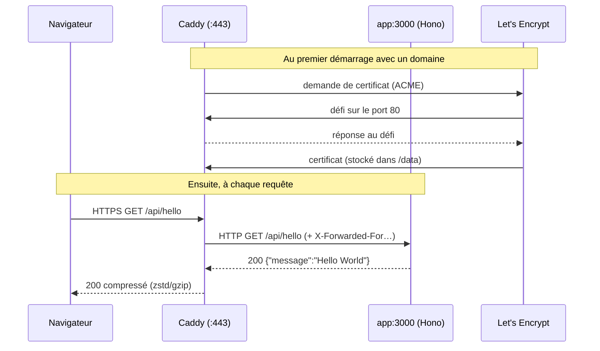

# Reverse proxy et HTTPS automatique avec Caddy

## TL;DR
Un **proxy inverse (reverse proxy)** est un serveur placé *devant* ton application : il reçoit toutes les requêtes des clients et les transmet à l'app. Il centralise le HTTPS, la compression, les logs, et devient l'**unique porte d'entrée**. **Caddy** est un reverse proxy qui obtient et renouvelle **automatiquement** les certificats HTTPS (via Let's Encrypt) dès qu'on lui donne un nom de domaine.

## Pourquoi ça existe
Sans reverse proxy, chaque application devrait gérer elle-même TLS, les certificats et leur renouvellement, la compression, HTTP/2 et HTTP/3, l'écoute sur les ports privilégiés 80/443… et ce, en tournant en root. Ça duplique du code délicat et sensible dans chaque app. Le reverse proxy fait ce travail une fois, bien, et l'app reste simple (HTTP en clair sur un port interne).

## Explication détaillée

### L'intuition : l'accueil d'un hôtel
Les clients ne frappent pas directement aux chambres : ils passent par **l'accueil** (Caddy). L'accueil vérifie, oriente vers la bonne chambre (`app:3000`), et c'est la seule porte donnant sur la rue. Les chambres n'ont pas de porte extérieure (`app` n'a pas de `ports`).

### Proxy vs reverse proxy
- **Proxy (direct, forward)** : agit pour le compte du *client* (ex. proxy d'entreprise qui filtre la navigation).
- **Reverse proxy** : agit pour le compte du *serveur*. Le client croit parler à l'app ; il parle à Caddy.

### HTTPS automatique
Quand l'adresse du site est un nom de domaine public (ex. `legalhelp.exemple.fr`), Caddy :
1. contacte l'autorité de certification **Let's Encrypt** (protocole ACME) ;
2. prouve qu'il contrôle le domaine via un **défi (challenge)**, typiquement HTTP-01 (Let's Encrypt appelle `http://domaine/.well-known/acme-challenge/…` sur le port **80**) ou TLS-ALPN-01 (sur le 443) ;
3. stocke le certificat dans `/data`, le renouvelle avant expiration, et redirige HTTP → HTTPS.

Pour `localhost`, Caddy génère une **autorité de certification locale** : HTTPS fonctionne, mais le navigateur ne lui fait pas confiance (avertissement normal). Pour une adresse sans domaine comme `:80`, Caddy sert du HTTP simple.

### Le Caddyfile
Format minimaliste : une **adresse de site** suivie d'un bloc de **directives** (`reverse_proxy`, `encode`, `log`, `file_server`…). Les variables d'environnement s'écrivent `{$VAR}` ou `{$VAR:défaut}` et sont substituées au chargement.

## Schéma


## Exemples

### Exemple 1 — le plus simple : un reverse proxy local en une ligne
```bash
# Lance une app de test sur 3000 (n'importe quoi qui répond en HTTP)
python3 -m http.server 3000 &
# Caddy en mode commande, sans fichier de config
caddy reverse-proxy --from :8080 --to localhost:3000
```
```bash
curl -sI localhost:8080 | head -1
```
Sortie attendue :
```
HTTP/1.1 200 OK
```

### Exemple 2 — cas courant : Caddyfile avec domaine, compression et site statique
```caddyfile
legalhelp.exemple.fr {
	# Les appels d'API vont au back…
	handle /api/* {
		reverse_proxy app:3000
	}
	# …le reste est servi depuis des fichiers statiques
	handle {
		root * /srv/www
		file_server
	}
	encode zstd gzip
}
```
Avec ce seul fichier : certificat obtenu, HTTPS actif, `http://` redirigé vers `https://`.

### Exemple 3 — cas réaliste : adresse paramétrable + vérifications
```caddyfile
{$SITE_ADDRESS:localhost} {
	reverse_proxy app:3000 {
		# Caddy retire les instances qui échouent à ce check actif
		health_uri /api/health
		health_interval 10s
	}
	encode zstd gzip
	log
}
```
```bash
# Valider la syntaxe sans redémarrer
docker compose exec caddy caddy validate --config /etc/caddy/Caddyfile
# Recharger à chaud, sans couper les connexions
docker compose exec caddy caddy reload --config /etc/caddy/Caddyfile
```
Sortie attendue (validate, extrait) :
```
Valid configuration
```

## Pièges courants
- **Port 80 fermé** : le défi HTTP-01 de Let's Encrypt échoue → pas de certificat. Garder 80 ouvert même si on ne sert que de l'HTTPS.
- **DNS pas encore propagé** : si le domaine ne pointe pas sur l'IP du serveur, la validation échoue. Vérifier avec `dig +short legalhelp.exemple.fr` avant.
- **Perdre le volume `/data`** : Caddy redemande un certificat à chaque redémarrage et atteint les **limites de débit (rate limits)** de Let's Encrypt (ex. quelques certificats identiques par semaine) → site bloqué en HTTPS.
- **Exposer aussi l'app** : un `ports: ['3000:3000']` sur l'app crée une porte dérobée en HTTP clair qui contourne le proxy.
- **IP en dur** : `reverse_proxy 172.18.0.2:3000` casse au prochain redémarrage ; utiliser le nom du service.
- **L'app ne voit que l'IP de Caddy** : la vraie IP client est dans l'en-tête `X-Forwarded-For`. L'app doit le lire (et ne faire confiance qu'à son proxy) pour les logs ou la limitation de débit.
- **Tabulations vs espaces** : le Caddyfile accepte les deux, mais `caddy fmt` normalise ; un `}` mal placé donne des erreurs déroutantes.

## Vu dans le projet
- **Projet** : `/Users/yohan.h/Projet_perso/legalhelp`
- **Fichier** : `Caddyfile:9-22`
```caddyfile
{$SITE_ADDRESS:localhost} {
	reverse_proxy app:3000
	encode zstd gzip
	log
}
```
- `{$SITE_ADDRESS:localhost}` : l'adresse du site vient de la variable d'environnement, `localhost` par défaut. `localhost` → certificat local ; `:80` → HTTP simple sur l'IP du VPS ; un domaine → HTTPS Let's Encrypt. Une variable change, le fichier non.
- `reverse_proxy app:3000` : tout est transmis au service `app` de Compose, résolu par le DNS interne de Docker.
- `encode zstd gzip` : compression négociée avec le navigateur (en-tête `Accept-Encoding`).
- `log` : journal des requêtes sur stdout → `docker compose logs caddy`.

Côté `docker-compose.yml`, Caddy est le seul à publier des ports : `80` (défi ACME + redirection), `443` (HTTPS) et `443/udp` (HTTP/3 sur QUIC), et le volume `caddy_data:/data` conserve les certificats.

## Pour aller plus loin
- [Documentation Caddy](https://caddyserver.com/docs/)
- [HTTPS automatique](https://caddyserver.com/docs/automatic-https)
- [Directive reverse_proxy](https://caddyserver.com/docs/caddyfile/directives/reverse_proxy)
- [Concepts du Caddyfile (variables d'environnement)](https://caddyserver.com/docs/caddyfile/concepts)
- [Let's Encrypt — limites de débit](https://letsencrypt.org/docs/rate-limits/)

## Voir aussi
- [Docker Compose](../devops/docker-compose.md)
- [Health check](../devops/healthcheck.md)
- [GitOps](../devops/gitops.md)

## Quiz rapide
1. Pourquoi faut-il ouvrir le port 80 alors que le site est servi en HTTPS ?
<details><summary>Réponse</summary>

Pour le défi HTTP-01 de Let's Encrypt, qui vérifie le contrôle du domaine via `http://domaine/.well-known/acme-challenge/…`, et pour rediriger les visiteurs `http://` vers `https://`.
</details>

2. Quelle différence entre proxy et reverse proxy ?
<details><summary>Réponse</summary>

Le proxy agit pour le client (il sort vers Internet à sa place) ; le reverse proxy agit pour le serveur (il reçoit les requêtes entrantes et les distribue aux applications).
</details>

3. Que se passe-t-il si on supprime le volume `caddy_data` en production ?
<details><summary>Réponse</summary>

Les certificats sont perdus ; Caddy en redemande au démarrage. Répété, cela dépasse les limites de débit de Let's Encrypt et le site ne peut plus obtenir de certificat pendant un moment.
</details>
